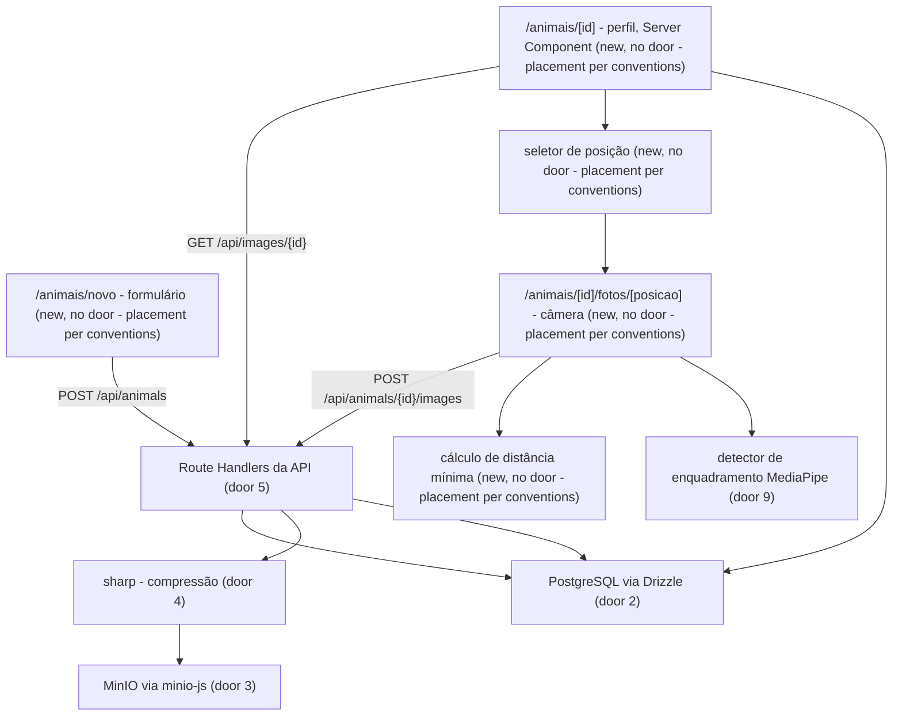
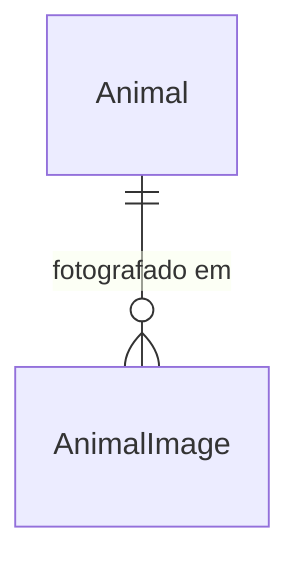

# Cadastro de animal e fotos por posição (dataset)

## Problem

O projeto não tem nenhuma imagem rotulada de bovino para treinar o classificador do PRD. Fotos
soltas no celular não dizem de que animal são, nem a categoria, idade, peso, sexo ou o ângulo
em que foram tiradas, e o §46 do PRD exige separar treino e teste **por animal**, o que só é
possível se cada foto estiver ligada ao animal certo. Fotos com o animal cortado ou longe demais
entram no treino como ruído e só são descobertas depois, na curadoria. Quem paga é a equipe de
ML, que não consegue começar o treino, e quem fotografa, que volta ao curral para refazer.
Nenhum número foi informado; a evidência é qualitativa.

Quando isto entrar: o técnico cadastra o animal com cinco campos, escolhe a posição (de trás, de
cima ou lateral), vê a distância mínima recomendada e um aviso ao vivo dizendo se o animal cabe
no quadro, e cada foto fica salva comprimida, ligada ao animal, à posição e ao peso e idade
daquele momento.

## Flow

Reusa o root layout e o Geist via `next/font` que já existem. O resto é novo, porque o
repositório ainda é o template do create-next-app.

1. formulário -> `POST /api/animals` (door 5) - valida, persiste `Animal` com `birth_date_estimated` (door 8) e devolve o animal; o navegador vai para o perfil
2. perfil (Server Component) lê `Animal` e `AnimalImage` direto do PostgreSQL (door 2) e mostra as três posições
3. seletor de posição -> câmera: `getUserMedia`, detector rodando a cada quadro (door 9) e distância mínima calculada a partir da categoria, do peso e da posição
4. disparo -> prévia -> `POST /api/animals/{id}/images` (door 5) - sharp gera JPEG e miniatura (door 4), grava os dois no MinIO (door 3), depois a linha `AnimalImage` com os snapshots (door 8)
5. out: `201` com a imagem; o perfil exibe as miniaturas por `GET /api/images/{id}`, que lê do MinIO

## Impact

| Front | What changes |
| --- | --- |
| domain | new term: `Categoria` - `TAURINE` ou `ZEBU`; substitui o campo "Raça" do PRD (§10) |
| domain | new term: `Posição` - `REAR` (de trás), `TOP` (de cima), `SIDE` (lateral); vira rótulo do dataset e parte da chave do objeto no MinIO |
| domain | new term: `Enquadramento` - `FRAMED`, `OUT_OF_FRAME`, `TOO_FAR`, `NOT_DETECTED`, `UNAVAILABLE`; estado do guia no instante do disparo, gravado com a foto para a curadoria |
| domain | existing term: no PRD o cadastro tinha **uma** foto obrigatória (§10); agora as fotos são várias por posição e vêm depois do cadastro - quem ramifica nisso hoje: ninguém no código, mas o plano parado da F1 assumia a foto única |
| domain | existing term: o PRD é offline-first e trata o backend só como sincronização (§21-22); nesta feature o servidor é a fonte da verdade e salvar exige conexão - a porta 5 do plano `avaliacao-offline` ("dados só no dispositivo") deixa de valer |
| stored data | nothing to migrate - PostgreSQL e MinIO nascem vazios |
| existing code | `app/page.tsx`, `app/layout.tsx` e `app/globals.css` do template são substituídos; `next.config.ts` ganha `output: 'standalone'` |
| infra | entram `docker-compose.yml` e um `Dockerfile`; o app passa a precisar de `DATABASE_URL` e das variáveis `S3_*` para subir |
| design | `Gado Certo - Telas.dc.html` (telas 2a, 2b, 2c, 2d, 1c, 1d, 1o, 1p, 1q) passa a ser a fonte visual; esta feature se afasta dele em sete pontos: (1) o campo se chama "Categoria", não "Raça"; (2) o cadastro não tem bloco de foto e conta "de 5", não "de 6"; (3) some o "· será salvo no aparelho" do rodapé; (4) no perfil, "Analisar este animal" vira "Fotografar animal", a lista de avaliações vira fotos por posição, e o lápis de editar e o selo PRONTO não aparecem; (5) na lista, o selo vira "N FOTOS" e a última linha vira "Última foto"; (6) na câmera, o lugar da Galeria vira o contador da posição; (7) a revisão pergunta "boa para o dataset?" e confirma com "Usar foto" |
| navegação | a barra inferior de 5 abas do design não entra: só a área Animais existe, e `/` redireciona para `/animais` |

## Relations

One-way constraints: identificação do animal única sem diferenciar maiúsculas e espaços nas
pontas (door 6); categoria, sexo, posição e enquadramento como enums fechados (door 7);
cada `AnimalImage` pertence a exatamente um `Animal` e carrega o peso e a idade do animal no
momento da foto (door 8); a chave do objeto no MinIO é única por imagem (door 3). No columns
and no types here.

## Surface

| Route | In | Out | Status |
| --- | --- | --- | --- |
| `POST /api/animals` | `id` (uuid gerado no navegador), `externalId`, `category`, `sex`, `age`, `ageUnit`, `weightKg` | `{ animal }` · `{ error, fields }` | `201`, `200`, `409`, `422` |
| `POST /api/animals/{id}/images` | multipart: `file`, `imageId` (uuid), `position`, `framing`, `minDistanceM`, `capturedAt` | `{ image }` · `{ error }` | `201`, `200`, `404`, `413`, `415`, `422`, `500`, `503` |
| `GET /api/images/{id}` | `variant` = `full` ou `thumb` | bytes `image/jpeg` ou `image/webp` | `200`, `404` |

## Landing

| One-way door | Literal shape | Alternative rejected |
| --- | --- | --- |
| 1. Infra local | `docker-compose.yml` com `db` (`postgres:17-alpine`, volume `pgdata`), `minio` (`quay.io/minio/minio:RELEASE.2025-09-07T16-13-09Z`, volume `miniodata`), `minio-init` (`quay.io/minio/mc`, cria o bucket privado `animal-images`) e `app` (`Dockerfile` multi-stage com `output: 'standalone'`); variáveis `DATABASE_URL`, `S3_ENDPOINT`, `S3_PORT`, `S3_USE_SSL`, `S3_ACCESS_KEY`, `S3_SECRET_KEY`, `S3_BUCKET` | `minio/minio:latest` do Docker Hub - o repositório foi apagado em 2026-09-11; o app criar o bucket ao subir - exige credencial de admin no app e corre entre réplicas |
| 2. Banco e migrações | `drizzle-orm` + `pg` + `drizzle-kit`; schema em `db/schema.ts`, migrações SQL em `drizzle/`, aplicadas com `migrate()` antes do `server.js` subir | Prisma - linguagem de schema própria e etapa `prisma generate` no build e na imagem Docker; `pg` com SQL à mão - sem schema tipado e sem diff de migração |
| 3. Armazenamento de imagens | cliente `minio` (minio-js); chaves `animals/{animalId}/{position}/{imageId}.jpg` e `animals/{animalId}/{position}/{imageId}_thumb.webp`; bucket privado, lido só pelo servidor em `GET /api/images/{id}` | URL pré-assinada - a assinatura amarra o host, e dentro do Compose o `minio:9000` interno não é o host que o navegador alcança; bucket público - o §43 do PRD proíbe imagem pública |
| 4. Compressão (irreversível: o original é descartado) | sharp: `autoOrient()` -> `resize(2048, 2048, { fit: 'inside', withoutEnlargement: true })` -> `jpeg({ quality: 85, mozjpeg: true })`, metadados removidos (padrão do sharp); miniatura `resize(320, 320, { fit: 'inside' })` -> `webp({ quality: 70 })` | guardar o original junto - dobra o armazenamento sem ganho para treino, que roda abaixo de 1024 px; WebP no arquivo principal - JPEG é o que as ferramentas de treino leem sem conversão; comprimir no navegador - a qualidade varia por aparelho e o sharp foi a ferramenta escolhida |
| 5. API em Route Handlers com ID do cliente | `app/api/animals/route.ts`, `app/api/animals/[id]/images/route.ts`, `app/api/images/[id]/route.ts`; `id` e `imageId` são `crypto.randomUUID()` gerados no navegador; repetir um `id` já salvo devolve `200` com o registro existente | Server Actions - limite padrão de 1 MB no corpo (uma foto passa disso) e o ID da action muda a cada build, então a fila offline futura não consegue reenviar |
| 6. Unicidade da identificação | índice único em `lower(trim(external_id))` na tabela `animals`, global | único por fazenda - não existe entidade fazenda (decisão aberta 5 do PRD); quando ela existir, o índice vira composto `(farm_id, lower(trim(external_id)))` e exige migração |
| 7. Rótulos do dataset | enums do Postgres: `category` (`TAURINE`, `ZEBU`), `sex` (`MALE`, `FEMALE`), `position` (`REAR`, `TOP`, `SIDE`), `framing` (`FRAMED`, `OUT_OF_FRAME`, `TOO_FAR`, `NOT_DETECTED`, `UNAVAILABLE`) | texto livre - os rótulos derivam ("lateral", "Lateral", "lado") e o dataset perde a chave de agrupamento |
| 8. Idade e snapshots | `animals.birth_date_estimated` (data) + `age_input_unit` (§10 do PRD); cada imagem grava `weight_kg_at_capture` e `age_months_at_capture` | guardar a idade como número - congela no dia do cadastro; ler peso e idade do animal na hora de exportar - depois de uma edição de peso a foto antiga ficaria com o rótulo errado |
| 9. Detector de enquadramento | `@mediapipe/tasks-vision` `ObjectDetector` com EfficientDet-Lite0 (COCO), `categoryAllowlist: ['cow']`, `scoreThreshold: 0.5`, `runningMode: 'VIDEO'`; `.wasm` e `.tflite` servidos de `public/mediapipe/` | CDN do jsDelivr com `@latest` e modelo no googleapis em tempo de execução - a versão muda sem aviso e uma queda de terceiro desliga o guia; detecção no servidor - uma ida e volta de rede por quadro |
| 10. Ferramental de teste | Vitest (unidade: distância, validação, pipeline do sharp com imagens de fixture; integração: API contra o Postgres e o MinIO do `docker compose`) + Playwright em Chromium com `--use-fake-device-for-media-stream` | mocks de Postgres e MinIO - não pegam o índice único nem a falha de bucket; Jest - exige transformação extra para ESM/TS |
| 11. Ícones | pacote `material-symbols` (Apache-2.0) com `import 'material-symbols/rounded.css'` e a classe `material-symbols-rounded` | folha do Google Fonts, como no arquivo de design - uma requisição externa a cada abertura, que quebra a fila offline planejada; `next/font/google` - não tem Material Symbols na lista de fontes |
| 12. Tokens do design | `@theme` do Tailwind v4 em `app/globals.css`: `--color-primary: #1F6B45`, `--color-primary-dark: #154C35`, `--color-primary-soft: #EAF5EF`, `--color-bg: #F6F8F7`, `--color-ink: #17211C`, `--color-muted: #68736D`, `--color-line: #DDE4E0`, `--color-error: #B23E2F`, `--color-ready: #18864B`, `--color-warn: #E8A93A`; raios 12 / 14 / 16-20 | hex direto em cada componente, como no arquivo de design - a paleta deriva entre telas e cada feature seguinte copia o desvio |

- Nothing else in this change is hard to reverse

## Criteria

### S1: Cadastrar o animal (P1)

O técnico registra um animal com os cinco campos na tela "Novo animal" (design 2a/2b) e cai no
perfil dele.

**Acceptance Criteria**

1. WHEN o usuário preenche categoria, identificação, idade, peso e sexo e toca "Salvar animal" THEN the system SHALL criar o animal e abrir `/animais/{id}`
2. The system SHALL mostrar em `/animais/novo` o título "Novo animal", o botão fechar (ícone `close`) e os campos na ordem Identificação, Categoria, Idade, Peso, Sexo, seguidos da "Prévia do card"
3. WHILE algum dos cinco campos está vazio the system SHALL manter "Salvar animal" desabilitado (fundo `#EEF0EF`, texto `#9AA39E`) e mostrar "X de 5 preenchidos" no rodapé fixo
4. WHEN os cinco campos estão preenchidos THEN the system SHALL mostrar "5 de 5 preenchidos" com o ícone `check_circle` em `#18864B` e habilitar "Salvar animal" com fundo `#1F6B45`
5. The system SHALL oferecer a categoria como dois cartões, "Taurino" com a legenda "Sem cupim" e "Zebu" com "Com cupim", e marcar o escolhido com borda `#1F6B45` e um check
6. The system SHALL oferecer o sexo como os botões "Macho" (ícone `male`) e "Fêmea" (ícone `female`)
7. The system SHALL receber a idade como número com o seletor "Meses" | "Anos" (padrão "Meses"), mostrar a unidade dentro do campo ("24 meses") e a conversão abaixo dele ("= 2 anos")
8. The system SHALL mostrar o peso com a unidade "kg" fixa dentro do campo
9. WHEN um campo muda THEN the system SHALL atualizar a "Prévia do card" para "Animal #<identificação>", "<categoria> • <sexo>" e "<idade> • <peso> kg"
10. WHEN o animal é salvo com idade 24 meses em 2026-10-04 THEN the system SHALL gravar `birth_date_estimated` = 2024-10-04
11. The system SHALL exibir a idade calculada a partir de `birth_date_estimated`: em meses até 35 meses e em anos a partir de 36 ("3 anos")
12. IF o peso não é inteiro entre 30 e 1500 kg THEN the system SHALL mostrar "Confira o peso informado" e não salvar
13. IF a identificação está vazia ou passa de 20 caracteres THEN the system SHALL mostrar "Informe uma identificação de até 20 caracteres" e não salvar
14. IF a identificação já existe, ignorando maiúsculas e espaços nas pontas ("a12 " = "A12") THEN the system SHALL mostrar "Já existe um animal com este ID." no campo de identificação
15. IF `POST /api/animals` recebe uma identificação já usada por outro animal THEN the system SHALL responder `409` com `fields.externalId` e não gravar nada
16. The system SHALL mostrar os erros de campo ao sair do campo ou ao tentar salvar, nunca enquanto o usuário digita, com o ícone `error` e o texto em `#B23E2F`
17. The system SHALL abrir teclado numérico (`inputmode="numeric"`) nos campos de idade e peso
18. WHILE o dispositivo está offline the system SHALL desabilitar "Salvar animal" e mostrar "Sem internet — conecte-se para salvar."
19. WHEN `POST /api/animals` recebe um `id` já salvo THEN the system SHALL responder `200` com o animal existente e não criar outro registro
20. IF o corpo de `POST /api/animals` é inválido THEN the system SHALL responder `422` com `{ error, fields }` listando cada campo inválido

**Independent test:** cadastrar um animal, tentar cadastrar outro com a mesma identificação em minúsculas e ver o erro.

### S2: Encontrar o animal na lista (P1)

A tela Animais (design 2d) lista o que já foi cadastrado e quanto de foto cada animal tem.

**Acceptance Criteria**

21. WHEN o usuário abre `/` THEN the system SHALL redirecionar para `/animais`
22. The system SHALL mostrar em `/animais` o título "Animais", a linha "N cadastrados" e o botão "Adicionar animal", que abre `/animais/novo`
23. The system SHALL listar os animais do mais recente para o mais antigo, cada item com a miniatura da foto principal (76 px), "Animal #023", "Taurino • Macho", "24 meses • 485 kg" e "Última foto: <data e hora>"
24. The system SHALL mostrar em cada item o selo "N FOTOS" ou, quando o animal não tem foto, "SEM FOTOS"
25. WHEN o usuário digita em "Buscar brinco ou ID" THEN the system SHALL mostrar só os animais cuja identificação contém o texto, sem diferenciar maiúsculas
26. WHEN o usuário toca um dos chips "Todos", "Taurino", "Zebu", "Machos" ou "Fêmeas" THEN the system SHALL mostrar só os animais daquele grupo ("Todos" remove o filtro)
27. IF não há animal cadastrado THEN the system SHALL mostrar o estado vazio do design 1q com o ícone `sell`, "Nenhum animal cadastrado" e o botão "Adicionar animal"
28. IF a busca ou o chip não encontra nenhum animal THEN the system SHALL mostrar "Nenhum animal encontrado"

**Independent test:** cadastrar um Taurino macho e uma Zebu fêmea, filtrar por "Fêmeas" e buscar pela identificação em minúsculas.

### S3: Fotografar por posição com guia de distância e enquadramento (P1)

Antes de cada sessão de fotos o técnico escolhe a posição, e a câmera (design 1c) diz a que
distância ficar e se o animal cabe no quadro; a revisão (design 1d) confirma a foto.

**Acceptance Criteria**

29. WHEN o usuário toca "Fotografar animal" no perfil THEN the system SHALL pedir a posição entre "De trás", "De cima" e "Lateral" antes de abrir a câmera
30. The system SHALL mostrar a câmera com "Cancelar" no topo à esquerda, o chip de conexão no topo à direita, a instrução "Posicione o animal inteiro dentro da área", a moldura com cantos, quatro dicas e, no terço inferior, o contador da posição, o disparo de 88 px e "Dicas"
31. The system SHALL usar como primeira dica "Fotografe por trás", "Fotografe de cima" ou "Fotografe de lado", conforme a posição, seguida de "Boa iluminação", "Só um animal" e "Corpo inteiro"
32. The system SHALL desenhar os cantos da moldura sobre o quadro capturado recuado 5% em cada borda
33. The system SHALL mostrar na câmera a posição escolhida e "Distância mínima: X,X m", arredondada para cima na casa de 0,1 m
34. The system SHALL calcular a distância mínima como `max(L / (2·tan(θL/2)·0,9), A / (2·tan(θA/2)·0,9))`, onde L e A são as dimensões do animal na largura e na altura do quadro (lateral: comprimento × altura; de trás: largura × altura; de cima: comprimento × largura), o lado maior do quadro tem ângulo `hfov`, o lado menor tem `tan(θ/2) = tan(hfov/2) × lado menor / lado maior`, e 0,9 deixa 5% de margem em cada borda
35. The system SHALL obter L e A das dimensões de referência de um animal de 450 kg (comprimento 2,4 m, altura 1,4 m, largura 0,7 m) multiplicadas por `(peso/450)^(1/3)`
36. WHEN a posição é "Lateral", o peso é 450 kg, o `hfov` é 65° e o quadro é 4:3 na horizontal THEN the system SHALL mostrar "Distância mínima: 2,1 m"
37. WHILE o celular está na vertical the system SHALL calcular com os eixos trocados (o mesmo animal lateral de 450 kg mostra "Distância mínima: 2,8 m")
38. WHEN o detector encontra uma vaca (`cow`) com score ≥ 0,5 cuja caixa fica a pelo menos 5% de todas as bordas e cobre pelo menos 50% do quadro em pelo menos um dos eixos THEN the system SHALL mostrar "Enquadrado" e pintar os cantos da moldura de `#7FD1A3`
39. IF a caixa detectada invade a margem de 5% de qualquer borda THEN the system SHALL mostrar "Afaste-se — o animal não cabe no quadro" e pintar os cantos de `#E8A93A`
40. IF a caixa detectada cobre menos de 50% do quadro nos dois eixos THEN the system SHALL mostrar "Aproxime-se" e pintar os cantos de `#E8A93A`
41. IF nenhuma vaca é detectada com score ≥ 0,5 THEN the system SHALL mostrar "Animal não detectado" e pintar os cantos de branco
42. WHILE o detector está carregando the system SHALL mostrar "Carregando guia de enquadramento..." e a distância mínima já calculada
43. IF o detector falha ao carregar THEN the system SHALL mostrar "Guia de enquadramento indisponível" e manter o disparo habilitado
44. The system SHALL manter o disparo habilitado em todos os estados de enquadramento e gravar com a foto o estado do instante do disparo (`FRAMED`, `OUT_OF_FRAME`, `TOO_FAR`, `NOT_DETECTED` ou `UNAVAILABLE`)
45. WHEN o usuário dispara THEN the system SHALL mostrar a revisão com a foto ocupando cerca de dois terços da tela, a pergunta "Esta foto está boa para o dataset?", a posição e o estado de enquadramento, "Usar foto" como ação primária e "Tirar outra foto" como secundária
46. WHEN o usuário toca "Tirar outra foto" THEN the system SHALL descartar a foto e voltar à câmera
47. WHEN o usuário toca "Usar foto" THEN the system SHALL enviar a foto, voltar à câmera na mesma posição e mostrar o contador "N fotos"
48. WHEN o usuário toca "Cancelar" THEN the system SHALL voltar ao perfil do animal
49. IF a permissão de câmera é negada THEN the system SHALL mostrar "Permita o acesso à câmera nas configurações do navegador" e o botão "Tentar novamente"
50. WHILE o dispositivo está offline the system SHALL desabilitar "Usar foto" e mostrar "Sem internet — conecte-se para enviar."

**Independent test:** com câmera falsa mostrando uma vaca inteira, ver "Enquadrado"; com a vaca cortada, ver "Afaste-se"; tirar duas fotos na lateral e ver o contador em 2.

### S4: Guardar a foto comprimida ligada ao animal (P1)

Cada foto aceita vira um JPEG comprimido e uma miniatura no MinIO, com a linha que a liga ao
animal, à posição e ao momento.

**Acceptance Criteria**

51. WHEN uma foto 4000 × 3000 sem rotação EXIF é enviada THEN the system SHALL gravar um JPEG de 2048 × 1536 sem metadados EXIF
52. WHEN uma foto 4000 × 3000 com EXIF `Orientation` = 6 é enviada THEN the system SHALL gravar o JPEG já girado, com 1536 × 2048
53. WHEN uma foto é enviada THEN the system SHALL gravar uma miniatura WebP com o maior lado de no máximo 320 px
54. The system SHALL gravar os arquivos no bucket `animal-images` nas chaves `animals/{animalId}/{position}/{imageId}.jpg` e `animals/{animalId}/{position}/{imageId}_thumb.webp`
55. The system SHALL gravar em cada imagem a posição, o enquadramento, a distância mínima exibida, `capturedAt`, largura, altura, tamanho em bytes, `weight_kg_at_capture` e `age_months_at_capture`
56. IF o arquivo passa de 15 MB THEN the system SHALL responder `413` e não gravar nada
57. IF o arquivo não é uma imagem que o sharp decodifica THEN the system SHALL responder `415` e não gravar nada
58. IF o animal não existe THEN the system SHALL responder `404` e não gravar nada
59. IF `position` ou `framing` não pertence ao enum THEN the system SHALL responder `422` e não gravar nada
60. IF o MinIO recusa a gravação THEN the system SHALL responder `503` e não gravar a linha no banco
61. IF a gravação no banco falha depois do upload THEN the system SHALL apagar os objetos que gravou e responder `500`
62. WHEN `POST /api/animals/{id}/images` recebe um `imageId` já salvo THEN the system SHALL responder `200` com a imagem existente sem gravar outro objeto nem outra linha
63. WHEN `GET /api/images/{id}?variant=thumb` é chamado THEN the system SHALL responder `200` com `image/webp`; com `variant=full`, `200` com `image/jpeg`; com um id inexistente, `404`
64. The system SHALL negar leitura anônima no bucket `animal-images` (uma leitura direta no MinIO sem credencial recebe `403`)

**Independent test:** enviar uma foto 4000 × 3000 com EXIF `Orientation` = 6 e conferir no MinIO o JPEG 1536 × 2048 em pé, sem EXIF, e a miniatura.

### S5: Ver o animal e as fotos por posição (P1)

O perfil (design 2c) mostra o animal e quanto do dataset dele já existe em cada posição.

**Acceptance Criteria**

65. The system SHALL mostrar no topo do perfil a foto principal (a lateral mais recente; sem lateral, a mais recente de qualquer posição; sem foto, um placeholder com o ícone `photo_camera`) e o botão voltar
66. The system SHALL mostrar no cartão do perfil "Animal #023" (26 px, peso 700), "Taurino • Macho", "24 meses • 485 kg", a grade Categoria / Sexo / Idade / Peso ("24 m", "485 kg") e o botão primário "Fotografar animal"
67. The system SHALL mostrar no perfil as três posições com a contagem de fotos e as miniaturas da mais recente para a mais antiga
68. IF uma posição não tem fotos THEN the system SHALL mostrar "Nenhuma foto" nela e o botão "Adicionar fotos", que abre a câmera já nessa posição

**Independent test:** abrir o perfil de um animal com duas fotos laterais e nenhuma nas outras posições.

### S6: Subir o ambiente com Docker (P1)

Uma máquina limpa sobe o sistema inteiro com um comando.

**Acceptance Criteria**

69. WHEN `docker compose up` roda numa máquina sem volumes THEN the system SHALL subir o PostgreSQL e o MinIO, criar o bucket privado `animal-images`, aplicar as migrações e servir o app na porta 3000

**Independent test:** `docker compose down -v && docker compose up`, abrir `http://localhost:3000/animais` e cadastrar um animal.

### S7: Linguagem visual do design system (P1)

Toda tela desta feature usa os tokens do design 1o/1p.

**Acceptance Criteria**

70. The system SHALL usar Geist no texto, Material Symbols Rounded nos ícones e as cores do design system (primária `#1F6B45`, verde-escuro `#154C35`, verde-suave `#EAF5EF`, fundo `#F6F8F7`, texto `#17211C`, secundário `#68736D`)
71. The system SHALL dar a todo controle tocável uma área de pelo menos 44 × 44 px e às ações principais uma altura entre 56 e 60 px

**Independent test:** medir no Playwright a área de toque de cada botão das telas desta feature.

## Out of scope

| Excluded | Why |
| --- | --- |
| Editar e excluir animal; excluir foto | próxima feature; aqui a prévia "Usar foto / Tirar outra" já filtra a foto ruim antes do envio |
| Importar foto da galeria | o guia de distância e enquadramento só existe na câmera ao vivo |
| Fila offline para cadastro e fotos | decidido: online na v1; IDs gerados no navegador deixam a fila entrar depois sem migração |
| Calibrar o campo de visão por aparelho | o navegador não expõe o campo de visão da câmera; v1 usa um valor padrão |
| Exportar o dataset (manifesto e download para treino) | feature própria, depois que houver fotos para exportar |
| Checagem de nitidez e iluminação | o pedido foi distância mínima e enquadramento |
| Login, usuários e fazendas | não existem no MVP (Fase 4 do PRD) |
| Classificação Pronto / Não pronto | plano `avaliacao-offline`, parado até haver modelo treinado com este dataset |

## Assumptions

| Assumption | Chosen default | Rationale | Confirmed? |
| --- | --- | --- | --- |
| Significado de "categoria" | grupo racial `Taurino` / `Zebu`, o campo "Raça" do PRD | o PRD tem exatamente esses dois valores e o pedido lista os mesmos campos menos a foto | n |
| Foto obrigatória para salvar o animal | não; as fotos vêm depois do cadastro, no perfil | a posição precisa ser escolhida antes de cada foto | n |
| Campo de visão horizontal da câmera | 65° com o quadro na horizontal | a câmera principal de um celular fica perto de 65-70°; o valor menor dá uma distância maior, que é o lado seguro | n |
| Dimensões de referência (450 kg) | 2,4 m de comprimento, 1,4 m de altura, 0,7 m de largura, as mesmas para Taurino e Zebu | ordem de grandeza de um bovino adulto; falta validação de zootecnista | n |
| Limite do upload | 15 MB por foto | uma foto de 12-50 MP de celular fica entre 3 e 12 MB | n |
| Detecção vista de cima | o guia pode responder "Animal não detectado" na posição "De cima" | o COCO tem poucas vacas vistas de cima; por isso o disparo nunca é bloqueado | n |
| Nome do produto | "Gado Certo" no `<title>` | é o nome dos mockups (marcado como provisório); o PRD dizia "AgroVision" | n |
| Foto original | descartada; ficam o JPEG de 2048 px e a miniatura (porta 4) | perguntado e não respondido; enquanto o dataset tiver só dados de teste, guardar o original depois é uma mudança de código, não de dados | n |
| Perfil de verificação | `ui` - o verificador abre o design e compara cada tela | recomendado na conversa e seguido com "pode seguir" | n |

**Open questions:** três seguem abertas.

| # | Kind | Question | Until answered |
| --- | --- | --- | --- |
| 1 | blocks go-live | Onde o app vai rodar (rede local ou VPN, ou internet pública)? Sem login, qualquer um que tenha a URL grava no dataset | ok para uso local e em rede privada; não expor publicamente |
| 2 | open | Um zootecnista pode validar as dimensões de referência e dizer se Taurino e Zebu precisam de valores diferentes? | os critérios 35-37 usam os valores da tabela de premissas |
| 3 | blocks go-live | MinIO em produção: a última imagem comunitária (`RELEASE.2025-09-07T16-13-09Z`) não recebe mais correção de segurança | serve para desenvolvimento; para produção, decidir entre um build próprio do MinIO ou outro servidor S3 compatível (o minio-js fala com qualquer um) |

## Observable

| Surface | Decision | Landing |
| --- | --- | --- |
| screen `/animais` | empty state | AC 27 |
| screen `/animais` | empty result (busca / filtro) | AC 28 |
| screen `/animais` | density and ordering | AC 22, AC 23, AC 24 |
| screen `/animais` | loading state | n/a - Server Component, renderiza com os dados já lidos |
| screen `/animais` | error state | n/a - falha de banco cai na página de erro padrão do Next (`error.tsx`), sem decisão de produto |
| screen `/animais/novo` | layout and ordering | AC 2, AC 3, AC 4, AC 9 |
| screen `/animais/novo` | validation and error state | AC 12, AC 13, AC 14, AC 16, AC 20 |
| screen `/animais/novo` | offline state | AC 18 |
| screen `/animais/novo` | destructive action confirms | n/a - fechar o formulário descarta um cadastro que ainda não existe |
| screen `/animais/[id]` | empty state (sem foto) | AC 65, AC 68 |
| screen `/animais/[id]` | density and ordering | AC 66, AC 67 |
| screen `/animais/[id]` | error state (id inexistente) | n/a - `notFound()` mostra a página 404 padrão do Next |
| screen seletor de posição | ordering | AC 29 |
| screen câmera | layout | AC 30, AC 31, AC 32, AC 33 |
| screen câmera | loading state | AC 42 |
| screen câmera | error state | AC 43 |
| screen câmera | unauthorised state (permissão negada) | AC 49 |
| screen câmera | offline state | AC 50 |
| screen revisão | layout | AC 45 |
| screen revisão | destructive action confirms | n/a - "Tirar outra foto" descarta uma foto que ainda não foi enviada |
| all screens | unauthorised state (login) | n/a - não há usuários no MVP; ver pergunta aberta 1 |
| all screens | visual tokens and touch targets | AC 70, AC 71 |
| API `POST /api/animals` | error shape and codes | AC 15, AC 19, AC 20 |
| API `POST /api/animals/{id}/images` | error shape and codes | AC 56, AC 57, AC 58, AC 59, AC 60, AC 61, AC 62 |
| API `GET /api/images/{id}` | error shape and codes | AC 63 |
| all new `/api/*` | who may call it | n/a - sem autenticação no MVP; ver pergunta aberta 1 |
| all new `/api/*` | versioning, rate limits | n/a - o único cliente é este app, publicado junto; sem exposição pública ainda |

## Sources

- Pedido do usuário em 2026-10-04 - campos, posições, distância mínima, enquadramento e a stack Docker + PostgreSQL + MinIO + sharp
- Binding: Claude Design, projeto "Gado Certo UI mockups", arquivo `Gado Certo - Telas.dc.html` (https://claude.ai/design/p/96e99ff6-cd1e-4d21-b9d1-afca323c5bc7) - telas 2a, 2b, 2c, 2d, 1c, 1d e o design system 1o, 1p, 1q; os desvios estão em `Impact`
- `PRD v1.1.md` - §10 (idade e peso), §27 (Animal), §43 (imagens nunca públicas), §46 (separar por animal)
- Context7: `/lovell/sharp`, `/minio/minio-js`, `/drizzle-team/drizzle-orm-docs`, MediaPipe Object Detector (web) e o labelmap do COCO, que tem `cow`
