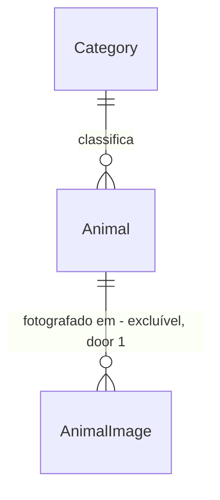

# Ajustes do dataset: revisão da galeria, excluir foto, "Novo cadastro" e imagem da categoria

## Problem

Quatro atritos apareceram no uso da coleta (pedido de 2026-11-23):

1. **A galeria do cadastro pula a revisão.** No formulário "Novo animal", a câmera mostra a
   revisão com a análise de qualidade, mas a foto da galeria entra direto no formulário. Os avisos
   ficam abaixo da prévia, fáceis de não ver, e quem cadastra não decide antes de a foto entrar.
2. **Uma foto ruim gravada não sai mais.** Não há como apagar uma foto já enviada, e ela fica no
   dataset que vai treinar o modelo.
3. **A aba Dataset gasta espaço.** O botão grande "Cadastrar animal" ocupa uma linha inteira, e a
   lista de categorias repete o que o formulário já mostra.
4. **O cartão de categoria não tem imagem.** Os cartões do formulário mostram o placeholder "foto
   referência", e uma categoria nova não pode receber uma imagem que ajude a reconhecê-la.

O pedido não traz números; a evidência são as telas atuais.

Quando isto entrar:
- a foto da galeria no cadastro passa pela mesma revisão da câmera;
- uma foto do perfil pode ser excluída, com confirmação;
- a aba Dataset tem "Novo cadastro" na linha do título, que abre um menu com "Animal" e "Categoria", e não lista mais as categorias;
- uma categoria nova pode ter uma imagem, que aparece no cartão do formulário.

## Flow

Reusa a revisão `PhotoReview` com a análise (`useFileQuality`, `modules/vision`), o
`ObjectStore` (`put`, `get`, `remove`), o processamento com `sharp` e o padrão de reenvio
idempotente do cadastro (animal salvo, foto que falha, "toque em Salvar para tentar de novo").

1. galeria do cadastro -> `PhotoField` (exists, `modules/dataset`) - abre `PhotoReview` (exists) com `useFileQuality` (exists); "Usar foto" / "Usar mesmo assim" guarda a foto com as métricas
2. perfil -> grade de fotos (new, no door - placement per conventions, `modules/photos/components`) - visualizador e confirmação; envia `DELETE /api/images/{id}` (new), que apaga a linha de `animal_images` e depois os objetos (door 1)
3. aba Dataset -> "Novo cadastro" (new, no door - placement per conventions) - menu com "Animal" (`/dataset/novo`, exists) e "Categoria" (`/dataset/categorias/nova`, exists)
4. nova categoria -> `CategoryForm` (exists) - `POST /api/categories` (exists) e, com imagem, `PUT /api/categories/{id}/image` (new, door 3), que grava `categories/{id}.webp` e `categories.image_key` (door 2)
5. out: o formulário "Novo animal" mostra a imagem por `GET /api/categories/{id}/image` (new)

## Impact

| Front | What changes |
| --- | --- |
| existing behaviour | escolher da galeria no formulário abre a revisão antes de a foto entrar. Quem depende disso hoje: os testes E2E que escolhem foto pela galeria no cadastro (`fillForm` de `helpers.ts`, `qualidade.spec.ts`) |
| existing behaviour | a aba Dataset perde a seção "Categorias" e troca "Cadastrar animal" por "Novo cadastro" com menu. Quem depende disso hoje: `dataset.spec.ts` (checks C1, C16, C17, C23, C29 e C33 da `dataset-rotulos`) |
| existing code | o perfil ganha a grade de fotos clicável (`modules/photos`); `app/api/images/[id]/route.ts` ganha `DELETE`; `modules/categories` ganha a imagem |
| stored data | migração `0004` com `categories.image_key` anulável. Taurino, Zebu e as categorias já criadas ficam sem imagem. Excluir uma foto apaga a linha e os objetos de verdade |

## Relations

One-way constraints: `Category` ganha uma imagem opcional (door 2). Uma `AnimalImage` excluída
deixa de existir, sem marca de exclusão (door 1).

## Surface

| Route | In | Out | Status |
| --- | --- | --- | --- |
| `DELETE /api/images/{id}` | - | vazio · `{ error }` | `204`, `404`, `500` |
| `PUT /api/categories/{id}/image` | `file` (multipart, imagem até 15 MB) | `{ category }` · `{ error, fields }` | `200`, `404`, `413`, `415`, `422`, `503` |
| `GET /api/categories/{id}/image` | - | `image/webp` · `{ error }` | `200`, `404` |

## Landing

| One-way door | Literal shape | Alternative rejected |
| --- | --- | --- |
| 1. Exclusão definitiva da foto | `DELETE /api/images/{id}`: apaga a linha de `animal_images`, depois `store.remove(objectKey)` e `store.remove(thumbKey)`. Se o MinIO falhar depois de a linha sair, responde `204` e registra as chaves em `console.error` | marca `deleted_at` - toda leitura do dataset (lista, perfil, resumo, exportação da F3) teria de filtrar, e o usuário quer a foto fora; apagar os objetos antes da linha - uma falha no banco deixaria uma linha apontando para um objeto que não existe mais |
| 2. Imagem da categoria | `categories.image_key text` anulável; objeto `categories/{id}.webp`, WebP qualidade 75, no máximo 640 px no lado maior, orientação EXIF aplicada; migração `drizzle/0004_*.sql` só com `ADD COLUMN` | `bytea` no banco - mistura binário com o domínio e foge do MinIO que já guarda as fotos; o pipeline das fotos (JPEG de 2048 px + miniatura) - desproporcional para um cartão de 70 px de altura |
| 3. Envio da imagem separado da criação | `POST /api/categories` continua JSON. A imagem vai depois em `PUT /api/categories/{id}/image`, que é idempotente por categoria: reenviar troca o mesmo objeto | `POST` multipart com o arquivo - muda o contrato que os testes e o cadastro de animal já usam, e mistura a criação idempotente por `id` com o envio que pode falhar no meio |

- Nothing else in this change is hard to reverse

## Criteria

### S1: A galeria do cadastro passa pela revisão (P1)

A foto da galeria é analisada e confirmada antes de entrar no formulário.

**Acceptance Criteria**

1. WHEN uma foto é escolhida pela galeria no formulário "Novo animal" THEN the system SHALL abrir a revisão "Esta foto está boa para o dataset?", com a posição escolhida, a análise de qualidade ("Verificando a foto..." e depois a lista de problemas) e as ações
2. WHEN o usuário toca "Usar foto" ou "Usar mesmo assim" na revisão da galeria THEN the system SHALL fechar a revisão e mostrar a foto no bloco "Foto do animal", com os mesmos avisos da revisão
3. WHEN o usuário toca "Escolher outra foto" na revisão da galeria THEN the system SHALL descartar a foto e abrir de novo o seletor de arquivos para a mesma posição
4. WHEN o usuário toca voltar (`arrow_back`) na revisão da galeria THEN the system SHALL descartar a foto e voltar ao formulário com o bloco vazio

**Independent test:** no cadastro, escolher pela galeria a imagem preta, ver a revisão com "Foto muito escura" e "Usar mesmo assim", tocar e ver a foto no bloco com o aviso.

### S2: Excluir uma foto do perfil (P1)

Uma foto ruim sai do dataset, com confirmação.

**Acceptance Criteria**

5. WHEN o usuário toca uma miniatura no perfil THEN the system SHALL abrir a foto em tela cheia, com a posição ("Lateral"), a data ("Hoje, 10:16"), o botão fechar (`close`) e o botão "Excluir foto"
6. WHEN o usuário toca "Excluir foto" THEN the system SHALL pedir confirmação com o título "Excluir esta foto?", o texto "A foto <posição> de <data> será apagada do dataset." e os botões "Cancelar" e "Excluir" (fundo `#B23E2F`)
7. WHEN o usuário confirma "Excluir" THEN the system SHALL apagar a foto e voltar ao perfil, com a contagem da posição sem ela ("2 fotos" vira "1 foto") e a foto principal recalculada
8. WHEN o usuário toca "Cancelar" na confirmação THEN the system SHALL fechar a confirmação e manter a foto aberta
9. WHEN `DELETE /api/images/{id}` recebe uma foto existente THEN the system SHALL apagar a linha de `animal_images` e os objetos `objectKey` e `thumbKey` do MinIO e responder `204`
10. IF `DELETE /api/images/{id}` recebe um id inexistente ou que não é uuid THEN the system SHALL responder `404`
11. IF o MinIO falha ao remover os objetos depois de a linha ser apagada THEN the system SHALL responder `204` e registrar as chaves em `console.error`
12. IF a exclusão da linha falha no banco THEN the system SHALL responder `500` e não remover nenhum objeto
13. IF a exclusão falha (resposta de erro ou rede) THEN the system SHALL mostrar "Não foi possível excluir a foto. Tente de novo." na confirmação e manter a foto
14. WHILE o dispositivo está offline the system SHALL desabilitar "Excluir" na confirmação e mostrar "Sem internet — conecte-se para excluir."

**Independent test:** no perfil com 2 fotos laterais, abrir uma, excluir, confirmar e ver "1 foto"; a linha e os objetos somem.

### S3: "Novo cadastro" na aba Dataset (P1)

O cadastro de animal e o de categoria partem de um botão compacto, e a aba não lista categorias.

**Acceptance Criteria**

15. The system SHALL mostrar em `/dataset` o botão "Novo cadastro" (ícone `add`, 44 px de altura, fundo `#1F6B45`) na mesma linha do título "Dataset", à direita
16. WHEN o usuário toca "Novo cadastro" THEN the system SHALL abrir um menu (`role="menu"`) com os itens "Animal" e "Categoria", nesta ordem
17. WHEN o usuário toca "Animal" no menu THEN the system SHALL abrir `/dataset/novo`, e WHEN toca "Categoria" THEN the system SHALL abrir `/dataset/categorias/nova`
18. WHEN o menu está aberto e o usuário toca fora dele ou aperta Escape THEN the system SHALL fechar o menu
19. The system SHALL mostrar em `/dataset`, de cima para baixo, só o cabeçalho (título, "<n> animais · <m> fotos" e "Novo cadastro"), o "Resumo" e os "Animais", sem a seção "Categorias"

**Independent test:** abrir `/dataset`, tocar "Novo cadastro" e ver "Animal" e "Categoria"; tocar "Categoria" e cair em `/dataset/categorias/nova`.

### S4: Imagem da categoria (P1)

Uma categoria nova pode ter uma imagem, que aparece no cartão do formulário.

**Acceptance Criteria**

20. The system SHALL mostrar em `/dataset/categorias/nova` o campo "Foto (opcional)" com o botão "Adicionar foto", que abre o seletor `image/*`. Com uma foto escolhida, mostra a prévia e o botão "Remover"
21. WHEN o usuário salva com uma foto THEN the system SHALL criar a categoria e enviar a imagem, gravada como `categories/{id}.webp` com no máximo 640 px no lado maior, e voltar para `/dataset`
22. The system SHALL mostrar a imagem da categoria no cartão do formulário "Novo animal", no lugar do placeholder "foto referência"; categoria sem imagem continua com o placeholder
23. IF a imagem falha depois de a categoria ser criada THEN the system SHALL mostrar "A categoria foi salva, mas a imagem não foi enviada. Toque em Salvar categoria para tentar de novo." e, ao tocar de novo, reenviar a imagem para a mesma categoria, sem criar outra
24. IF `PUT /api/categories/{id}/image` recebe um arquivo que não é imagem THEN the system SHALL responder `415`; com mais de 15 MB, `413`; sem arquivo, `422`; para uma categoria inexistente, `404`; com o MinIO fora, `503`
25. WHEN `GET /api/categories/{id}/image` pede uma categoria com imagem THEN the system SHALL responder `200` com `image/webp`; sem imagem ou sem categoria, `404`

**Independent test:** criar "Nelore" com uma foto, abrir "Novo animal" e ver a foto no cartão Nelore; Taurino continua com "foto referência".

## Supersedes

| Check antigo | O que fixava | Substituído por |
| --- | --- | --- |
| dataset-rotulos C1 | "Cadastrar animal" em `/dataset` abre `/dataset/novo` | AC 16, AC 17 ("Novo cadastro" › "Animal") |
| dataset-rotulos C16 | "+ Nova" na seção Categorias abre `/dataset/categorias/nova` | AC 17 ("Novo cadastro" › "Categoria") |
| dataset-rotulos C17 | a categoria salva aparece na seção Categorias de `/dataset` | AC 21 (volta para `/dataset`) e C18 da F1b (aparece no formulário e nos filtros) |
| dataset-rotulos C23 | "Angus" não aparece na seção Categorias | a mesma regra só no banco; a seção não existe (AC 19) |
| dataset-rotulos C29 | "Cadastrar animal" de 58 px abaixo do título, e as seções Resumo, Categorias e Animais | AC 15, AC 19 |
| dataset-rotulos C33 | lista de categorias com contagem de animais | AC 19 (sem lista) |
| qualidade-imagem C2 e C14 (parte do cadastro) | a foto da galeria entra direto no bloco | AC 1, AC 2 (passa pela revisão; os avisos no bloco continuam) |

## Out of scope

| Excluded | Why |
| --- | --- |
| Editar, excluir ou trocar a imagem de uma categoria depois de criada | AD-002 (categoria não é editada); a imagem entra só na criação |
| Desfazer a exclusão de uma foto | a confirmação existe para isso; a exclusão é definitiva (door 1) |
| Excluir foto pela câmera ou em lote | o pedido é excluir uma foto já cadastrada, no perfil |
| Checagem de qualidade na imagem da categoria | a imagem não vai para o dataset |
| Excluir animal | F2 `edicao-animal` |

## Assumptions

| Assumption | Chosen default | Rationale | Confirmed? |
| --- | --- | --- | --- |
| Revisão na galeria do cadastro | a mesma `PhotoReview`, com "Escolher outra foto" no lugar de "Tirar outra foto" | decisão do usuário; "tirar" não descreve escolher na galeria | y |
| Onde nasce a categoria | `/dataset/categorias/nova`, pelo menu "Novo cadastro"; o formulário "Novo animal" só escolhe | decisão do usuário (substitui o "+ Nova" no formulário) | y |
| Onde excluir a foto | tocar a miniatura no perfil abre a foto com "Excluir foto" e confirmação | o perfil é onde as fotos por posição já aparecem; a confirmação segue o padrão do PRD §42 ("Excluir ... ? Cancelar / Excluir") | n |
| Exclusão definitiva | apaga a linha e os objetos, sem lixeira | dataset em coleta, sem exportação ainda; uma lixeira exigiria filtrar toda leitura (door 1) | n |
| Tamanho do botão "Novo cadastro" | 44 px de altura, o mesmo do antigo "Adicionar animal" da aba Animais | "um pouquinho menor" que os 58 px atuais, no padrão de botão de cabeçalho do app | n |

**Open questions:** none - all resolved or logged above.

## Observable

| Surface | Decision | Landing |
| --- | --- | --- |
| screen revisão da galeria (cadastro) | loading / warning | AC 1 (com a análise da F1c) |
| screen revisão da galeria | destructive action confirms | n/a - descartar uma foto que não foi salva |
| screen visualizador de foto (perfil) | destructive action confirms | AC 6, AC 8 |
| screen visualizador de foto | error state | AC 13 |
| screen visualizador de foto | offline state | AC 14 |
| screen perfil | empty state depois de excluir a última foto da posição | existing - "Nenhuma foto" com "Adicionar fotos" (F1) |
| screen `/dataset` | density and ordering | AC 15, AC 19 |
| screen menu "Novo cadastro" | dismiss | AC 18 |
| screen nova categoria | error state da imagem | AC 23 |
| API `DELETE /api/images/{id}` | error shape and codes | AC 10, AC 11, AC 12 |
| API `PUT /api/categories/{id}/image` | error shape and codes | AC 24 |
| API `GET /api/categories/{id}/image` | codes | AC 25 |
| all new `/api/*` | versioning, rate limits, who may call | n/a - API interna do app, sem contas |

## Sources

- Pedido do usuário em 2026-11-23 e respostas na mesma sessão: revisão também na galeria do cadastro; "Novo cadastro" com menu "Animal" e "Categoria"; excluir foto já cadastrada; imagem na nova categoria; Dataset sem a lista de categorias
- `PRD v1.1.md` - §42 (padrão de confirmação de exclusão)
