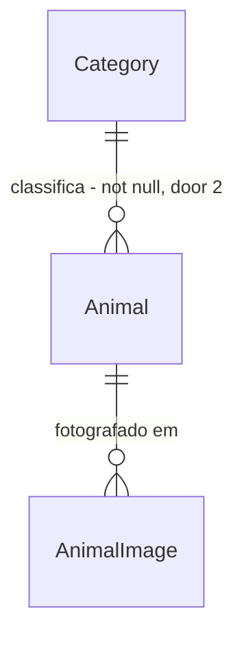

# Rótulos Pronto / Não pronto, categorias cadastráveis e aba Dataset

## Problem

As fotos que a F1 coleta vão treinar o classificador Pronto / Não pronto, mas nenhuma delas diz se
o animal estava pronto quando foi fotografado. O único atributo de grupo é a categoria, presa em
dois valores fixos no banco (`TAURINE` / `ZEBU`). Quem coleta não consegue registrar outra
categoria do rebanho (Nelore, cruzado) sem uma migração. Quem vai treinar o modelo recebe fotos
sem a classe que o modelo precisa aprender e teria de rotulá-las de memória depois, foto por foto.

Um animal também muda de estado: o garrote fotografado hoje como não pronto fica pronto meses
depois. Se o rótulo existir só no animal, a mudança regrava em silêncio a classe de todas as fotos
antigas. O pedido de 2026-11-22 não traz números; a evidência é o schema atual (`category` como
enum, nenhuma coluna de rótulo em `animal_images`).

Quando isto entrar:
- Todo animal é cadastrado com uma categoria, escolhida numa lista que o próprio usuário amplia, e
  com o rótulo Pronto ou Não pronto.
- Cada foto guarda o rótulo do momento em que foi tirada.
- A nova aba Dataset reúne o cadastro, as categorias, um resumo de fotos por rótulo e categoria e
  a lista de animais com filtros.
- A aba Animais passa a só listar.

## Flow

Reusa o formulário de cadastro, a lista de animais (`AnimalsList`), o upload com snapshots
(`uploadAnimalImage`), o padrão de criação idempotente com uuid do navegador e `uniqueViolation`
(`createAnimal`), o aviso offline do formulário e o `safeOrigin` da F4b. Nada disso é reescrito.

1. aba Dataset -> `/dataset` (new, no door - placement per conventions) - lê do banco, por
   `lib/animals/repo.ts` (exists) e um repositório de categorias (door 1):
   - contagem de fotos por `readiness_at_capture` × categoria do animal (door 3);
   - categorias com a contagem de animais;
   - animais para a `AnimalsList` (exists), que passa a receber filtros serializáveis.
2. "Cadastrar animal" -> `/dataset/novo` (new, no door - placement per conventions) - o formulário que hoje está em `app/animais/novo`
   (exists, muda de pasta). Recebe as categorias do servidor e envia
   `POST /api/animals` (exists, assinatura muda) com `categoryId` (door 2) e `readiness` (door 3).
   A foto do cadastro segue por `sendPhoto` (exists).
3. "+ Nova" -> `/dataset/categorias/nova` (new, no door - placement per conventions) - envia `POST /api/categories` (new), que grava
   `Category` (door 1) e devolve `409` para nome repetido pelo índice único.
4. foto enviada -> `POST /api/animals/{id}/images` -> `uploadAnimalImage` (exists) - grava
   `readiness_at_capture` a partir do animal lido no mesmo request, ao lado de
   `weight_kg_at_capture` (door 3). A chave no MinIO não muda (door 4).
5. perfil ou "Qual posição?" -> "Alterar" -> `/animais/{id}/rotulo?de=<origem>` (new, no door - placement per conventions) - envia
   `PUT /api/animals/{id}/readiness` (new). Grava `animals.readiness` e, com
   `scope=FIX_ALL_PHOTOS`, também `readiness_at_capture` de todas as fotos do animal, numa
   transação. Depois volta para `safeOrigin(de)` (exists).
6. out: a barra inferior (`components/tab-bar.tsx`, exists) troca Ajustes por Dataset; a Home
   (exists) ganha a engrenagem para `/ajustes`.

## Impact

| Front | What changes |
| --- | --- |
| domain | new term: `Readiness` - `READY` ou `NOT_READY`, o rótulo do dataset; mesmo vocabulário de `Decision` (F4b, door 2) sem `INCONCLUSIVE`, porque uma foto de treino sempre tem classe |
| domain | new term: `Category` - linha cadastrável com nome e descrição opcional; substitui o enum `category` |
| domain | existing term: `category` era o enum `TAURINE` / `ZEBU`. Passa a ser `categoryId`, uma referência a `Category`. Quem ramifica nele hoje: `CATEGORY_LABEL` e `animalSummary` (`lib/animals/format.ts`), os chips de `animals-list.tsx`, a grade do perfil, os cartões de `animal-form.tsx`, `validation.ts`, `repo.ts` e os helpers de teste (`tests/e2e/helpers.ts`, `tests/helpers/fixtures.ts`) |
| existing behaviour | o cadastro sai de `/animais/novo` para `/dataset/novo`. `/animais/novo` passa a cair em `/animais/[id]` com id inválido e responde `404`. A aba Animais perde "Adicionar animal" |
| existing behaviour | a barra perde Ajustes; `/ajustes` continua existindo e passa a ser aberto pela engrenagem da Home |
| existing checks | substitui os checks da F1 que fixavam rota, campos e botão de cadastro (ver `Supersedes`); os testes deles mudam no mesmo commit que muda o comportamento |
| roadmap | entra a F1b `dataset-rotulos`; a F3 `exportacao-dataset` passa a montar `<READY ou NOT_READY>/<categoria>/<posição>` a partir de `readiness_at_capture` e da categoria do animal |
| stored data | duas migrações geradas pelo drizzle-kit: `0001_dataset_labels` cria `categories` (com o seed), o enum `readiness` e as colunas novas; `0002_drop_category_enum` apaga `animals.category` e o tipo `category`. Em dois passos para o drizzle-kit não abrir a pergunta interativa de renomeação |
| stored data | sem backfill: os dados atuais são de teste (decisão do usuário em 2026-11-22). Antes de aplicar a migração, com confirmação no momento, `docker compose down -v` apaga `pgdata` (bancos `gado_certo` e `gado_certo_test`) e `miniodata`. Sem `--rmi`: a imagem do MinIO só existe em cache local |

## Relations

One-way constraints:
- nome de `Category` único sem diferença de caixa e de espaços nas pontas (door 1);
- `Animal` tem exatamente uma `Category` e um `Readiness` (doors 2 e 3);
- `AnimalImage` tem exatamente um `Readiness` de captura (door 3);
- `Category` não é renomeada nem excluída nesta feature.

## Surface

Only routes this adds or whose signature changes.

| Route | In | Out | Status |
| --- | --- | --- | --- |
| `POST /api/categories` | `id` (uuid do navegador), `name`, `description?` | `{ category }` · `{ error, fields }` | `201`, `200`, `409`, `422` |
| `POST /api/animals` | `id`, `externalId`, `categoryId`, `readiness`, `sex`, `age`, `ageUnit`, `weightKg` (`category` sai) | `{ animal }` · `{ error, fields }` | `201`, `200`, `409`, `422` |
| `PUT /api/animals/{id}/readiness` | `readiness`, `scope` (`FROM_NOW` ou `FIX_ALL_PHOTOS`) | `{ animal, photosUpdated }` · `{ error, fields }` | `200`, `404`, `422` |

`POST /api/animals/{id}/images` mantém a assinatura; a linha gravada ganha `readinessAtCapture`
(critério 13).

## Landing

| One-way door | Literal shape | Alternative rejected |
| --- | --- | --- |
| 1. Categorias como tabela | `categories(id uuid primary key, name varchar(30) not null, description varchar(40), created_at timestamptz not null default now())`; `CREATE UNIQUE INDEX categories_name_unique ON categories (lower(trim(name)))`; seed na migração: `('00000000-0000-4000-8000-000000000001', 'Taurino', 'Sem cupim')`, `('00000000-0000-4000-8000-000000000002', 'Zebu', 'Com cupim')`, ids exportados de `lib/categories/seed.ts` | manter o `pgEnum` e rodar `ALTER TYPE category ADD VALUE` a cada categoria nova - DDL em tempo de execução, feito pelo usuário do app; texto livre no animal - "Nelore", "nelore " e "Nelori" viram três grupos e o dataset perde a chave de agrupamento (motivo da door 7 da F1) |
| 2. Animal aponta para a categoria | `animals.category_id uuid not null references categories(id)` (on delete no action), índice `animals_category_id_idx`; a coluna `animals.category` e o tipo `category` saem | gravar o nome da categoria no animal - renomear exigiria reescrever todos os animais; `category_id` anulável - animal sem categoria entraria no dataset sem grupo |
| 3. Rótulo no animal e na foto | `CREATE TYPE readiness AS ENUM ('READY', 'NOT_READY')`; `animals.readiness readiness not null`; `animal_images.readiness_at_capture readiness not null`, copiado do animal no upload | rótulo só no animal, lido na exportação - a mudança de Não pronto para Pronto regravaria a classe das fotos antigas; `ready boolean` - o modelo e o PRD (§29, §30 `labels [READY, NOT_READY]`) usam esse vocabulário, e o rótulo do dataset tem de casar com o do modelo; valores em português ("PRONTO") - ajuste de texto viraria migração (mesma razão da door 2 da F4b) |
| 4. Chave do objeto não carrega rótulo | continua `animals/{animalId}/{position}/{imageId}.jpg` e `_thumb.webp` (`objectKeys`, `lib/images/upload.ts:27`); a árvore `<READY ou NOT_READY>/<categoria>/<posição>` é montada pela exportação a partir do banco | prefixar a chave com rótulo e categoria - corrigir um rótulo obrigaria a mover objetos no MinIO e um erro no meio deixaria banco e storage divergentes |
| 5. Migração sem backfill | `drizzle/0001_*.sql` adiciona as colunas `not null` sem `DEFAULT`; num banco com animais ela falha, o que serve de trava | backfill com `NOT_READY` - fabricaria rótulos no dataset, a falha que esta feature existe para evitar; `TRUNCATE` dentro da migração - apagaria os dados de qualquer banco que ainda não aplicou a 0001, sem perguntar |

- Nothing else in this change is hard to reverse

## Criteria

### S1: Cadastrar o animal com categoria e rótulo (P1)

O animal nasce com uma categoria da lista e o rótulo Pronto ou Não pronto.

**Acceptance Criteria**

1. WHEN o usuário toca "Cadastrar animal" na aba Dataset THEN the system SHALL abrir `/dataset/novo` com o título "Novo animal"
2. The system SHALL mostrar em `/dataset/novo` os blocos na ordem Foto, Identificação, Categoria, Rótulo, Idade, Peso, Sexo e "Prévia do card"
3. The system SHALL mostrar em Categoria um cartão por categoria cadastrada, em ordem de criação (Taurino e Zebu primeiro), numa grade de 2 colunas, cada um com o nome e, quando existir, a descrição ("Sem cupim", "Com cupim"); o escolhido ganha borda `#1F6B45` e um check
4. The system SHALL mostrar em Rótulo dois cartões, "Pronto" com a legenda "Pronto para abate" e "Não pronto" com "Ainda não está pronto"; "Pronto" escolhido ganha borda `#18864B` e fundo `#E3F3EA`, e "Não pronto" escolhido ganha borda `#C74A3A` e fundo `#FAEBE8`
5. The system SHALL contar 7 campos no rodapé ("<n> de 7 preenchidos") e habilitar "Salvar animal" só com 7 de 7
6. WHEN um rótulo é escolhido THEN the system SHALL mostrar na "Prévia do card" o selo "PRONTO" ou "NÃO PRONTO" com as cores do critério 36
7. WHEN o usuário salva o formulário completo THEN the system SHALL criar o animal com a categoria e o rótulo escolhidos e abrir `/animais/{id}`
8. WHEN o usuário toca "Fechar" em `/dataset/novo` THEN the system SHALL voltar para `/dataset`
9. IF `POST /api/animals` recebe `categoryId` ausente, que não é uuid, ou de uma categoria que não existe THEN the system SHALL responder `422` com `fields.categoryId` = "Escolha a categoria" e não criar o animal
10. IF `POST /api/animals` recebe `readiness` ausente ou diferente de `READY` e `NOT_READY` THEN the system SHALL responder `422` com `fields.readiness` = "Escolha o rótulo" e não criar o animal
11. The system SHALL mostrar o resumo "<categoria> • <sexo>" com o nome da categoria vindo do banco ("Nelore • Fêmea" para um animal de categoria Nelore) na lista, no perfil (linha e grade Categoria) e na prévia
12. IF o usuário abre `/animais/novo` THEN the system SHALL mostrar a página de não encontrado do Next ("This page could not be found.", com `<meta name="robots" content="noindex">`). Revisto em 2026-11-22 por decisão do usuário: antes pedia status `404`, mas com `app/loading.tsx` toda página dinâmica sai em streaming com `200`, e o `notFound()` vira um soft 404

**Independent test:** pela aba Dataset, cadastrar "023" Taurino, Não pronto, 24 meses, 485 kg, Macho e ver o perfil com "Taurino • Macho" e o selo NÃO PRONTO.

### S2: Cada foto guarda o rótulo da captura (P1)

O rótulo vai para a foto no instante do upload, não é lido do animal depois.

**Acceptance Criteria**

13. WHEN uma foto é gravada por `POST /api/animals/{id}/images` THEN the system SHALL gravar em `readiness_at_capture` o rótulo que o animal tem naquele momento
14. The system SHALL gravar a foto no MinIO em `animals/{animalId}/{position}/{imageId}.jpg`, sem rótulo nem categoria na chave, para os dois rótulos
15. The system SHALL ter, logo depois das migrações, as categorias Taurino ("Sem cupim", id `00000000-0000-4000-8000-000000000001`) e Zebu ("Com cupim", id `00000000-0000-4000-8000-000000000002`)

**Independent test:** cadastrar um animal Não pronto, enviar uma foto e ler `readiness_at_capture = 'NOT_READY'` na linha da foto e a chave sem rótulo.

### S3: Cadastrar uma categoria (P1)

O usuário amplia a lista de categorias sem migração e sem duplicar nomes.

**Acceptance Criteria**

16. WHEN o usuário toca "+ Nova" na seção Categorias da aba Dataset THEN the system SHALL abrir `/dataset/categorias/nova` com o título "Nova categoria", o botão fechar (`close`), os campos "Nome" e "Descrição (opcional)" e o botão "Salvar categoria" (58 px de altura)
17. WHEN o usuário salva um nome válido THEN the system SHALL criar a categoria e voltar para `/dataset`, onde ela aparece na seção Categorias
18. WHEN uma categoria é criada THEN the system SHALL oferecê-la como cartão em Categoria no `/dataset/novo` e como filtro nas listas das abas Animais e Dataset
19. IF o nome, sem os espaços das pontas, fica vazio ou passa de 30 caracteres THEN the system SHALL mostrar "Informe um nome de até 30 caracteres" no campo Nome e não criar a categoria (`422` com `fields.name`)
20. IF a descrição passa de 40 caracteres THEN the system SHALL responder `422` com `fields.description` = "A descrição tem no máximo 40 caracteres" e não criar a categoria
21. IF já existe uma categoria com o mesmo nome sem diferença de caixa e de espaços nas pontas ("nelore " com "Nelore" cadastrada) THEN the system SHALL responder `409` e mostrar "Já existe uma categoria com este nome." no campo Nome, sem criar outra
22. WHEN `POST /api/categories` recebe um `id` que já existe THEN the system SHALL responder `200` com a categoria existente, sem criar outra linha
23. WHEN o usuário toca fechar em `/dataset/categorias/nova` THEN the system SHALL voltar para `/dataset` sem criar nada
24. WHILE o dispositivo está offline the system SHALL desabilitar "Salvar categoria" e mostrar "Sem internet — conecte-se para salvar."

**Independent test:** criar "Nelore" com "Cruzado zebuíno", ver o cartão no formulário e o chip nas duas listas; tentar "nelore " e ver o erro de duplicado.

### S4: Aba Dataset e navegação (P1)

O cadastro e a visão do dataset ficam numa aba própria; a aba Animais só lista.

**Acceptance Criteria**

25. The system SHALL mostrar a barra inferior com, nesta ordem, Home, Histórico, Analisar (o botão central elevado), Animais e Dataset, sem a aba Ajustes
26. WHEN o usuário toca a aba Dataset THEN the system SHALL abrir `/dataset` com a aba Dataset ativa (`aria-current="page"`, cor `#1F6B45`) e o ícone `dataset`
27. The system SHALL mostrar no topo da Home, depois do chip de conexão, a engrenagem (`settings`, 44 × 44 px, `aria-label="Ajustes"`) que leva a `/ajustes`
28. WHEN o usuário abre `/ajustes` THEN the system SHALL mostrar "Configurações" e "Em breve", com a barra inferior e nenhuma aba ativa
29. The system SHALL mostrar em `/dataset`, de cima para baixo: o título "Dataset" com "<n> animais · <m> fotos" ("1 animal · 1 foto" no singular), o botão "Cadastrar animal" (ícone `add`, fundo `#1F6B45`), a seção "Resumo", a seção "Categorias" e a seção "Animais"
30. The system SHALL mostrar no Resumo um cartão "PRONTO" (título em `#18864B`) e um "NÃO PRONTO" (título em `#C74A3A`), cada um com "<m> fotos" daquele rótulo e, abaixo, "<categoria> <n>" para cada categoria com foto naquele rótulo, em ordem de criação, separados por " · " ("Taurino 2 · Zebu 1")
31. The system SHALL contar no Resumo cada foto pelo `readiness_at_capture`, de forma que 2 fotos tiradas como Não pronto e 1 tirada depois de mudar o animal para Pronto com "O animal mudou" dão NÃO PRONTO 2 e PRONTO 1
32. WHILE não existe nenhuma foto the system SHALL mostrar no Resumo "Nenhuma foto ainda" no lugar dos dois cartões
33. The system SHALL listar em Categorias, em ordem de criação, cada categoria com o nome, " · <descrição>" quando existir e "<n> animais" à direita ("1 animal", "0 animais"), e o botão "+ Nova" no título da seção
34. The system SHALL mostrar na seção Animais da aba Dataset a busca "Buscar brinco ou ID" e os filtros Todos · Pronto · Não pronto · um por categoria em ordem de criação; Pronto e Não pronto filtram pelo rótulo atual do animal
35. WHILE nenhum animal está cadastrado the system SHALL mostrar na seção Animais da aba Dataset "Nenhum animal cadastrado"
36. The system SHALL mostrar em cada linha das listas de animais (abas Animais e Dataset) o selo do rótulo atual: "PRONTO" com fundo `#E3F3EA` e texto `#136B3C`, ou "NÃO PRONTO" com fundo `#FAEBE8` e texto `#C74A3A`
37. The system SHALL não mostrar "Adicionar animal" na aba Animais, nem no cabeçalho nem no estado vazio
38. WHILE nenhum animal está cadastrado the system SHALL mostrar na aba Animais "Nenhum animal cadastrado", "Cadastre animais na aba Dataset." e o link "Ir para Dataset" (44 px de altura) que leva a `/dataset`
39. The system SHALL mostrar na aba Animais os filtros Todos · um por categoria em ordem de criação · Machos · Fêmeas

**Independent test:** abrir a aba Dataset vazia ("Nenhuma foto ainda", "Nenhum animal cadastrado"), cadastrar dois animais com rótulos diferentes, enviar fotos e ver o Resumo e os filtros Pronto / Não pronto.

### S5: Mudar o rótulo depois do cadastro (P1)

O usuário atualiza o estado do animal sem estragar a classe das fotos já tiradas, ou corrige um erro de cadastro de propósito.

**Acceptance Criteria**

40. The system SHALL mostrar no perfil o selo do rótulo atual ao lado do título "Animal #<id>" e, entre a grade e "Fotografar animal", a linha "Rótulo" com o selo e o link "Alterar" (44 px de altura) para `/animais/{id}/rotulo?de=/animais/{id}`
41. The system SHALL mostrar em "Qual posição?" a linha "As fotos serão salvas como" com o selo do rótulo atual e o link "Alterar" (44 px) para `/animais/{id}/rotulo?de=/animais/{id}/fotos`
42. WHEN `/animais/{id}/rotulo` abre THEN the system SHALL mostrar o voltar (`arrow_back`, 44 px), "Animal #<id>", o título "Alterar rótulo", os cartões "Pronto" e "Não pronto" do critério 4 com o rótulo atual marcado e o botão "Salvar rótulo" (58 px)
43. WHILE o animal tem fotos the system SHALL mostrar em `/animais/{id}/rotulo` a pergunta "Por que mudar?" com "O animal mudou" ("Só as fotos novas recebem o rótulo novo.") e "Corrigir erro de cadastro" ("As <n> fotos já tiradas também mudam.", ou "A foto já tirada também muda." com 1 foto)
44. WHILE o animal não tem fotos the system SHALL não mostrar "Por que mudar?" e salvar com `scope=FROM_NOW`
45. WHILE o rótulo marcado é o atual, ou o animal tem fotos e nenhum motivo foi escolhido, the system SHALL manter "Salvar rótulo" desabilitado
46. WHEN o usuário salva com "O animal mudou" THEN the system SHALL mudar o rótulo do animal, manter o `readiness_at_capture` das fotos já gravadas e voltar para `de`
47. WHEN o usuário salva com "Corrigir erro de cadastro" THEN the system SHALL mudar o rótulo do animal e o `readiness_at_capture` de todas as fotos dele numa transação, responder `photosUpdated` com o número de fotos e voltar para `de`
48. WHEN o usuário toca voltar em `/animais/{id}/rotulo` THEN the system SHALL voltar para `de` sem mudar nada
49. IF o `de` de `/animais/{id}/rotulo` não é um caminho deste app (`//host`, `/\host`, `https://host`, ausente ou repetido) THEN the system SHALL usar `/animais/{id}` como destino do voltar e do salvar
50. IF `PUT /api/animals/{id}/readiness` recebe um id sem animal THEN the system SHALL responder `404`; e `/animais/{id sem animal}/rotulo` SHALL mostrar a página de não encontrado com `noindex` (soft 404, revisto em 2026-11-22 pela mesma razão do critério 12)
51. IF `PUT /api/animals/{id}/readiness` recebe `readiness` ou `scope` fora dos valores THEN the system SHALL responder `422` com o campo em `fields` e não mudar nada
52. WHILE o dispositivo está offline the system SHALL desabilitar "Salvar rótulo" e mostrar "Sem internet — conecte-se para salvar."
53. The system SHALL dar a todo controle tocável das telas novas (`/dataset`, `/dataset/categorias/nova`, `/animais/{id}/rotulo`) e da engrenagem da Home pelo menos 44 × 44 px

**Independent test:** animal Não pronto com 2 fotos; mudar para Pronto com "O animal mudou", enviar 1 foto e ver NÃO PRONTO 2 / PRONTO 1 no Resumo; depois mudar para Não pronto com "Corrigir erro de cadastro" e ver NÃO PRONTO 3.

## Supersedes

Checks aprovados de outras features que esta mudança substitui, por decisão do usuário em
2026-11-22. Os testes deles mudam no mesmo commit que muda o comportamento; nenhum é apagado sem
o critério novo que o substitui.

| Check antigo | O que fixava | Substituído por |
| --- | --- | --- |
| cadastro-animal C2 | rota `/animais/novo` e ordem sem Foto nem Rótulo | AC 1, AC 2, AC 12 |
| cadastro-animal C3, C4 | rodapé "de 5" (já era "de 6" desde `b49d14f`) | AC 5 |
| cadastro-animal C5 | exatamente dois cartões fixos, Taurino e Zebu | AC 3 |
| cadastro-animal C14 | duplicado fica em `/animais/novo` | a mesma regra em `/dataset/novo` (AC 1); a mensagem não muda |
| cadastro-animal C23 | "Adicionar animal" em `/animais` abre `/animais/novo` | AC 1, AC 37 |
| cadastro-animal C28 | estado vazio de `/animais` com "Adicionar animal" | AC 38 |
| cadastro-animal C76 | alvos de toque em `/animais/novo` | a mesma regra em `/dataset/novo`; telas novas em AC 53 |
| testes da barra (`navegacao.spec.ts`, sem check formal) | cinco abas com Ajustes; Ajustes "Em breve" pela barra | AC 25, AC 26, AC 28 |

## Out of scope

Product capabilities only. Process and harness rules live in AGENTS.md or as Observable `n/a`.

| Excluded | Why |
| --- | --- |
| Renomear ou excluir categoria | renomear mudaria o grupo de fotos já tiradas e excluir deixaria animais sem categoria; precisa de regra própria |
| Editar os outros campos do animal, "+ Pesar", excluir foto | F2 `edicao-animal` |
| Exportar o dataset (manifesto, download, treino/teste) | F3 `exportacao-dataset`, que passa a usar `readiness_at_capture` |
| Corrigir o rótulo de uma foto isolada | o pedido corrige por animal; por foto entra com a exclusão de foto da F2 |
| Foto de referência por categoria | os cartões mantêm o placeholder "foto referência"; depende de imagens com direito de uso (pergunta aberta 7 do PRD) |
| Resultado confirmado de uma avaliação alimentando o dataset (PRD §47) | F6 `registro-avaliacoes` |

## Assumptions

| Assumption | Chosen default | Rationale | Confirmed? |
| --- | --- | --- | --- |
| A foto copia só o rótulo | `readiness_at_capture` sim; a categoria é lida do animal na exportação | categoria não muda com o tempo; trocar é corrigir, e as fotos devem acompanhar | y |
| "Alterar rótulo" com motivo | "O animal mudou" (só fotos novas) ou "Corrigir erro de cadastro" (todas as fotos do animal) | evita que um erro de digitação vire classe errada nas fotos, e que uma mudança real regrave o passado | y |
| Corrida entre correção e upload simultâneo do mesmo animal | sem trava: o upload lê o animal e grava a foto como hoje; uma foto enviada durante a transação de correção pode ficar com o rótulo anterior | um técnico por animal, ações sequenciais na tela; travar a linha do animal no upload custa mais do que o caso | n |
| Voltar do perfil aberto pela aba Dataset | o voltar do perfil continua indo para `/animais` | o perfil é a página do animal nas duas abas; passar origem ao perfil fica para quando houver mais de uma entrada real | n |
| Ordem das categorias | ordem de criação, Taurino e Zebu primeiro | as duas são as do PRD e as mais usadas; nova categoria aparece no fim, onde o usuário a procura | n |
| Legendas dos cartões de rótulo | "Pronto para abate" e "Ainda não está pronto" | o PRD usa "Pronto para abate"; o vocabulário proibido da F4b ("autorizado", "aprovado") não aparece | n |

**Open questions:** none - all resolved or logged above.

## Observable

| Surface | Decision | Landing |
| --- | --- | --- |
| screen `/dataset` | empty state | AC 32, AC 35 |
| screen `/dataset` | loading state | n/a - página renderizada no servidor; chega pronta |
| screen `/dataset` | error state | existing - erro de banco cai na página de erro do Next, como a aba Animais hoje |
| screen `/dataset` | unauthorised state | n/a - o MVP não tem contas nem login |
| screen `/dataset` | density and ordering | AC 29, AC 30, AC 33, AC 34 |
| screen `/dataset/novo` | states | existing - validação, duplicado, offline e falha da foto do formulário da F1; AC 5 muda o contador |
| screen `/dataset/novo` | density and ordering | AC 2, AC 3, AC 4 |
| screen `/dataset/categorias/nova` | error state | AC 19, AC 20, AC 21 |
| screen `/dataset/categorias/nova` | offline state | AC 24 |
| screen `/dataset/categorias/nova` | empty / loading | n/a - formulário sem dados carregados |
| screen `/animais/{id}/rotulo` | destructive action confirms | AC 43, AC 45 - a correção de fotos antigas exige escolher o motivo, que mostra quantas fotos mudam |
| screen `/animais/{id}/rotulo` | offline state | AC 52 |
| screen `/animais/{id}/rotulo` | error state | AC 50 (animal inexistente: a página de não encontrado, como o perfil) |
| screen aba Animais | empty state | AC 38 |
| screen aba Animais | density and ordering | existing - mais recente primeiro (F1 C24); AC 36, AC 39 |
| screen Home | ordering do topo | AC 27 |
| all new screens | touch targets | AC 53 |
| API `POST /api/categories` | error shape and codes | AC 19, AC 20, AC 21, AC 22 - mesmo formato `{ error, fields }` de `POST /api/animals` |
| API `PUT /api/animals/{id}/readiness` | error shape and codes | AC 50, AC 51 |
| API `POST /api/animals` | error shape and codes | AC 9, AC 10 |
| all new `/api/*` | versioning, rate limits, who may call | n/a - API interna do próprio app, sem contas e sem consumidor externo |
| collection categorias | grouping, naming, duplicates | AC 21 (duplicado), AC 33 (ordem); nomes livres até 30 caracteres |
| collection dataset | grouping criterion | AC 30, AC 31 - rótulo de captura × categoria do animal |
| copy dos cartões de rótulo | tom e vocabulário | AC 4; vocabulário da F4b em `Assumptions` |

## Sources

- Pedido do usuário em 2026-11-22 e respostas na mesma sessão: rótulo e categoria como campos separados, rótulo gravado em cada foto, aba Dataset com cadastro, resumo, categorias e lista com filtros, barra sem Ajustes e engrenagem na Home, dados atuais de teste
- Binding: as prévias aprovadas na mesma sessão (barra "Home · Histórico · (Analisar) · Animais · Dataset" e aba "Dataset / Cadastrar animal / Resumo / Categorias"); para as telas que já existem, Claude Design `Gado Certo - Telas.dc.html` (https://claude.ai/design/p/96e99ff6-cd1e-4d21-b9d1-afca323c5bc7), telas 2a, 2b, 2c e 1a, com os desvios em `Impact` e `Supersedes`
- `PRD v1.1.md` - §29 e §30 (vocabulário `READY` / `NOT_READY`), §46 (dataset), cores Pronto / Não pronto do design system
