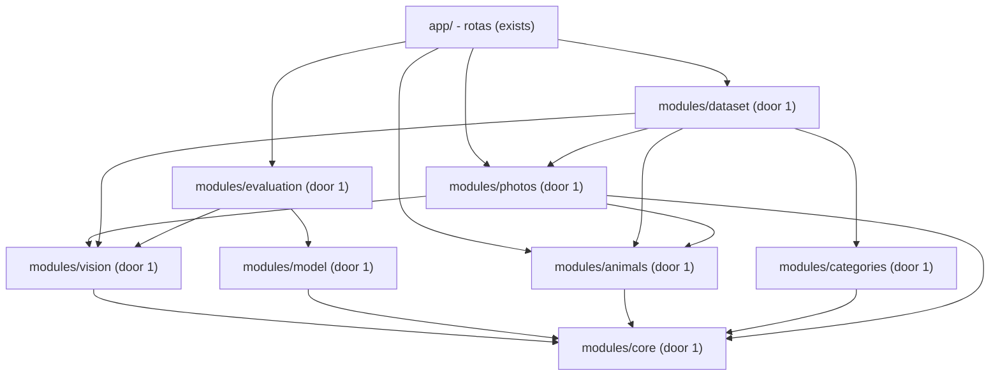

# Estrutura modular

## Problem

O código está organizado por camada técnica (`lib/`, `components/` e componentes colados nas
rotas de `app/`), não por domínio. A visão computacional está espalhada por quatro lugares:
- `lib/camera`: detector, enquadramento, guia e distância;
- `components/guided-camera.tsx`: a câmera;
- `lib/animals/format.ts`: as posições de foto;
- `lib/photos/main-photo.ts`.

O "modelo" mora em `lib/evaluation`, misturado com o fluxo de telas. Quem vai escrever a próxima
feature de visão (checagem de qualidade, PRD §41) ou o adaptador do modelo (F5) não tem um
lugar óbvio para isso. Nada impede um módulo de depender de qualquer outro, nem um componente
client de importar código que só roda no servidor (`pg`, `sharp`). Hoje `categories` já depende
de `animals` só para reaproveitar um helper de validação.

O pedido de 2026-11-22 não traz números. A evidência é o grafo de imports atual, levantado no
planejamento.

Quando isto entrar, cada domínio vive em `modules/<nome>/`. Tudo de visão computacional está em
`modules/vision`, e o modelo de IA em `modules/model`. `app/` fica só com as rotas. Um teste de
lint falha quando um módulo importa outro fora das dependências permitidas. O usuário do app não
vê nenhuma mudança.

## Flow

Reusa todo o código existente sem reescrever lógica: os arquivos mudam de pasta com `git mv` e
os imports passam aos caminhos novos. O caminho de cada requisição continua o mesmo; o que muda
é o grafo de dependências entre módulos (door 2).

## Impact

| Front | What changes |
| --- | --- |
| domain | new term: `módulo` - pasta `modules/<nome>/` dona de um domínio, com `components/` (client) e `server/` (só servidor) quando precisar |
| existing code | `lib/` e `components/` deixam de existir. Componentes de domínio saem de `app/` para os módulos: `animal-form`, `photo-field`, `category-form`, `readiness-form`, `evaluation-flow`, `result-view`, `model-status`, `gallery-button`, `camera-capture`, `animals-list`, `rows` |
| existing code | `POSITION_*`, `positionFromSlug` e o tipo `Position` passam a morar em `modules/vision/positions.ts`. `photoCountLabel` e `formatWhen` vão para `modules/core/format`; `firstErrors`, para `modules/core/validation`; `datasetPhotoCounts` e `SummaryRow`, de `animals/repo` para `dataset/server/repo`. Quem os importava hoje: as rotas, `guided-camera`, `main-photo`, `send-photo`, `categories/validation` e `dataset/summary` |
| config | `drizzle.config.ts` (caminho do schema), `instrumentation.ts` (caminho do migrate), `vitest.config.mts` (alias de `server-only`), `eslint.config.mjs` (fronteiras) |
| tests | só os imports mudam. Nomes e asserções ficam iguais, então as provas citadas nos `checks.md` das features anteriores seguem valendo |
| specs | os `plan.md` / `checks.md` / `verification.md` antigos citam caminhos de `lib/` e `components/`; são registros históricos e não são reescritos |
| stored data | nothing to migrate - o schema não muda, só o arquivo muda de pasta |

## Relations

None - no stored-data shape change. `modules/core/db/schema.ts` é o mesmo schema em outro
caminho.

## Surface

None - nothing consumed outside. Nenhuma rota de página ou de API muda de caminho, de entrada ou
de saída.

## Landing

| One-way door | Literal shape | Alternative rejected |
| --- | --- | --- |
| 1. Pasta dos módulos | `modules/{core,vision,model,evaluation,animals,categories,photos,dataset}/` na raiz. Dentro de cada módulo, `components/` para client e `server/` para o que só roda no servidor. Sem `index.ts`: importa por caminho (`@/modules/vision/detection/framing`). Visão: `vision/{detection,geometry,camera,quality}/` e `vision/positions.ts`. Modelo: `model/{classifier,decision}.ts` e `model/components/` | `src/` com `app` e `modules` - o usuário escolheu a raiz; muda alias, drizzle, Docker e testes sem ganho de comportamento. Barrels `index.ts` - um barrel que reexporta client e server puxa `pg`/`sharp` para o bundle do navegador. Componentes em pastas privadas `app/**/_components` - a câmera e a lógica de visão servem a três rotas e ficariam presas a uma |
| 2. Dependências permitidas | `core`: nenhum módulo; `vision`, `model`, `categories`, `animals`: `core`; `photos`: `core`, `vision`, `animals`; `evaluation`: `core`, `vision`, `model`; `dataset`: `core`, `vision`, `animals`, `categories`, `photos`; `app/`: todos. Fiscalizado em `eslint.config.mjs` por um bloco `no-restricted-imports` por pasta, com `patterns: ["@/modules/<proibido>/*"]` | só convenção num README - nada falha quando alguém quebra; `dependency-cruiser` - dependência nova para uma regra que o ESLint já expressa |
| 3. Marcador de servidor | `import "server-only";` como primeira linha de todo arquivo em `modules/*/server/`, em `modules/core/db/{client,migrate}.ts` e em `modules/core/storage/object-store.ts`. No Vitest, um alias leva `server-only` a `tests/setup/server-only.ts` (vazio). `modules/core/db/schema.ts` fica sem o marcador | instalar o pacote `server-only` - pelos docs do Next 16 é opcional, o Next resolve sozinho; marcar o `schema.ts` - o drizzle-kit carrega esse arquivo em Node puro, fora do Next, e quebraria |

- Nothing else in this change is hard to reverse

## Criteria

### S1: Nada muda para quem usa o app (P1)

As mesmas telas, rotas, APIs e dados, depois da mudança de pastas.

**Acceptance Criteria**

1. WHEN as suítes de teste existentes rodam THEN the system SHALL passar com os mesmos números de antes (unidade 74, integração 38, E2E 156), sem teste removido, pulado ou com asserção alterada
2. The system SHALL mudar nos arquivos de teste só linhas de import em relação ao commit base
3. WHEN `pnpm drizzle-kit generate` roda THEN the system SHALL responder que não há mudança de schema e não criar arquivo em `drizzle/`
4. WHEN `pnpm build` roda THEN the system SHALL compilar sem erro, o que inclui nenhum componente client importando um arquivo marcado com `server-only`

**Independent test:** rodar as três suítes e o build, e abrir as telas no `pnpm dev`.

### S2: Módulos com fronteiras fiscalizadas (P1)

Cada domínio tem uma pasta, e o lint barra a dependência que a tabela não permite.

**Acceptance Criteria**

5. The system SHALL ter em `modules/` exatamente as pastas `core`, `vision`, `model`, `evaluation`, `animals`, `categories`, `photos` e `dataset`, e nenhuma pasta `lib/` nem `components/` na raiz
6. The system SHALL manter em `app/` só arquivos de rota e de metadata: `page.tsx`, `layout.tsx`, `loading.tsx`, `route.ts`, `globals.css`, `icon.png` e `apple-icon.png`
7. The system SHALL reunir em `modules/vision`:
   - o detector MediaPipe com o gancho `__gadoDetector`;
   - a classificação do enquadramento;
   - o retângulo-guia;
   - a distância mínima;
   - as posições de foto;
   - a câmera guiada com a revisão.
8. The system SHALL reunir em `modules/model` a porta do classificador (`loadClassifier`, `ModelUnavailableError`, o gancho `__agroClassifier`), a política de decisão por limiar e o componente de status do modelo
9. IF um arquivo de um módulo importa um módulo fora das dependências da door 2 THEN `pnpm lint` SHALL falhar com `no-restricted-imports` naquele import
10. WHEN um arquivo de um módulo importa um módulo permitido pela door 2 THEN `pnpm lint` SHALL não acusar `no-restricted-imports`
11. The system SHALL ter `import "server-only";` como primeira linha de todo arquivo em `modules/*/server/`, de `modules/core/db/client.ts`, `modules/core/db/migrate.ts` e `modules/core/storage/object-store.ts`, e nenhum nessa linha em `modules/core/db/schema.ts`
12. The system SHALL descrever em `modules/README.md` cada um dos 8 módulos e a tabela de dependências da door 2
13. The system SHALL não ter nenhum import `@/lib/` nem `@/components/` em `app/`, `modules/`, `tests/` e `instrumentation.ts`

**Independent test:** trocar um import de `modules/vision` para `@/modules/animals/...` e ver `pnpm lint` falhar; desfazer e ver passar.

## Out of scope

| Excluded | Why |
| --- | --- |
| Checagem de qualidade da foto (desfoque, luz, nenhum bovino, mais de um animal) | próxima feature, já dentro de `modules/vision/quality` (decisão do usuário em 2026-11-22) |
| Adaptador Edge Impulse e pacote do modelo | F5 `avaliacao-offline`; passa a morar em `modules/model` |
| Reescrever lógica ou renomear funções | é mudança de pastas e imports; renomear muda o diff de comportamento que esta feature promete não ter |
| Mover os testes para dentro dos módulos | `vitest.config.mts` e `playwright.config.ts` apontam para `tests/`; mover não organiza o domínio |

## Assumptions

| Assumption | Chosen default | Rationale | Confirmed? |
| --- | --- | --- | --- |
| Lugar do formulário de cadastro | `modules/dataset/components/{animal-form,photo-field}.tsx` | o formulário monta animal com foto; em `animals` ele criaria o ciclo `animals` ↔ `photos`, porque o upload já depende de `animals` | y |
| Lugar das posições de foto | `modules/vision/positions.ts` | posição é o ângulo da câmera; a câmera guiada e a distância mínima dependem dela, e `vision` não pode depender de domínio | y |
| Lugar do `loader.svg` | `modules/core/ui/loader.svg`, importado por `app/loading.tsx` | é um asset do fallback global, não um arquivo de rota | n |
| Ajustes rápidos de nome de arquivo | `rows.ts` passa a `to-rows.ts` e os arquivos mantêm os nomes atuais no resto | o nome novo diz o que a função faz; nenhuma função exportada muda de nome | n |

**Open questions:** none - all resolved or logged above.

## Observable

None - no user-facing surface. As telas, as rotas e as APIs não mudam (AC 1, AC 4). A superfície
nova é do desenvolvedor: o lint (AC 9, AC 10) e o `modules/README.md` (AC 12).

## Sources

- Pedido do usuário em 2026-11-22: "Organizar o código de maneira modular, deve ter o módulo que contém tudo sobre visão computacional, módulo futuro do modelo entre outros"; escolha de `modules/` na raiz
- `node_modules/next/dist/docs/01-app/01-getting-started/02-project-structure.md` ("Store project files outside of `app`") e `05-server-and-client-components.md` (`server-only` opcional)
