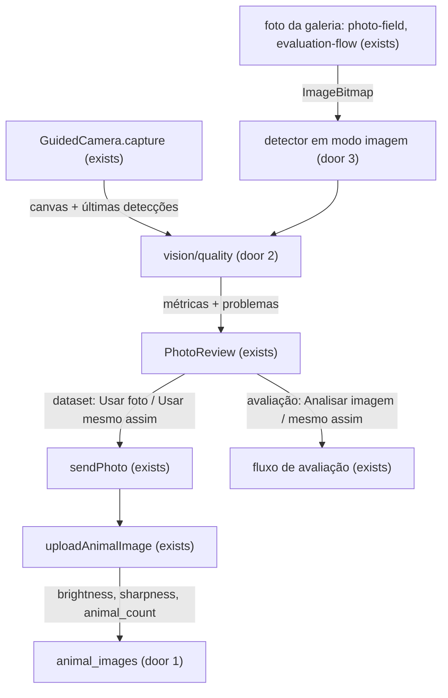
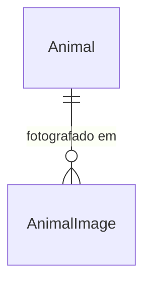

# Verificação de qualidade da foto

## Problem

A foto que entra no dataset ou na avaliação não passa por nenhuma checagem de qualidade. O
detector de bovino roda ao vivo na câmera, mas só para o enquadramento. Uma foto desfocada,
escura, estourada, sem animal ou com dois animais é aceita igual a uma boa. Quem coleta só
descobre o problema depois, se descobrir. Quem treina recebe essas fotos misturadas, sem nenhum
número que permita filtrá-las.

As fotos da galeria nem passam pelo detector: o cadastro grava `UNAVAILABLE` e a avaliação
analisa qualquer imagem. O PRD prevê a checagem (§41: "blur, luminosidade, tamanho do animal,
enquadramento, presença de bovino"; §42: "Nenhum bovino encontrado"). O pedido de 2026-11-23 não
traz números; a evidência são as colunas de `animal_images`, que não guardam nenhuma métrica de
qualidade.

Quando isto entrar, a revisão de toda foto (câmera ou galeria, no dataset e na avaliação) lista
os problemas encontrados e deixa seguir com "Usar mesmo assim" ou "Analisar mesmo assim". Cada
foto do dataset guarda o brilho, a nitidez e o número de bovinos detectados.

## Flow

Reusa o detector MediaPipe (`modules/vision/detection/detector.ts`, com o gancho
`__gadoDetector`), a revisão `PhotoReview` e a captura de `GuidedCamera`
(`modules/vision/camera`), o envio `sendPhoto` e o upload `uploadAnimalImage`. A medição nova
mora em `modules/vision/quality`.

## Impact

| Front | What changes |
| --- | --- |
| domain | new term: `QualityMetrics` - `{ brightness, sharpness, animalCount }` de uma foto, medido no aparelho (door 2) |
| domain | new term: `QualityIssue` - `NO_ANIMAL`, `MULTIPLE_ANIMALS`, `BLURRY`, `TOO_DARK`, `TOO_BRIGHT`; derivado das métricas por limites provisórios |
| existing behaviour | o botão principal da revisão muda de rótulo quando há problema ("Usar mesmo assim" / "Analisar mesmo assim"). Quem depende do rótulo hoje: os testes E2E que tiram foto com o detector falso sem bovino (`camera.spec.ts` "enquadramento gravado", o `fakeDetector` de `helpers.ts` usado por `avaliacao.spec.ts`) |
| existing code | `Detector` ganha `detectImage` (opcional: o gancho de teste pode não ter); `CapturedPhoto` e `PhotoToSend` ganham `quality`; `PhotoReview` ganha `issues` e um estado "verificando" |
| stored data | migração `0003` com três colunas anuláveis em `animal_images`. As fotos já gravadas ficam com `null` ("não medido"); sem backfill |

## Relations

One-way constraints: `AnimalImage` ganha `brightness`, `sharpness` e `animal_count`, todos
anuláveis (door 1). Nenhuma entidade nova.

## Surface

| Route | In | Out | Status |
| --- | --- | --- | --- |
| `POST /api/animals/{id}/images` | os campos de hoje + `brightness?`, `sharpness?`, `animalCount?` | `{ image }` (com as três métricas) · `{ error, fields }` | `201`, `200`, `404`, `413`, `415`, `422`, `500`, `503` |

## Landing

| One-way door | Literal shape | Alternative rejected |
| --- | --- | --- |
| 1. Métricas por foto | `animal_images.brightness real`, `animal_images.sharpness real`, `animal_images.animal_count smallint`, todos `null` permitido; migração `drizzle/0003_*.sql` só com `ADD COLUMN` | colunas `not null` - as fotos já gravadas não têm medida e um valor inventado entraria no dataset; guardar só os problemas (`text[]`) - os limites são provisórios, e com o número bruto a curadoria recalcula sem refotografar |
| 2. Definição das métricas | `brightness` = média da luma Rec.601 (`0.299R + 0.587G + 0.114B`, de 0 a 255) e `sharpness` = variância populacional do Laplaciano de 4 vizinhos em tons de cinza, sem as bordas. As duas são medidas na foto reduzida por média de blocos k × k, com k = ⌈maior lado / 512⌉ (no máximo 512 px no lado maior), em JavaScript, sem o redimensionamento do canvas. `animal_count` = detecções `cow` com score ≥ 0.5 do EfficientDet-Lite0, o mesmo filtro do enquadramento; `null` quando o detector não está disponível. Uma função só, `measureQuality` em `modules/vision/quality`, para câmera e galeria | `sharp.stats().sharpness` no servidor - mede outra coisa (desvio-padrão de outro Laplaciano, na foto de 2048 px), e o aviso da revisão e o número gravado discordariam; medir na resolução cheia - o número muda com a câmera do celular e as fotos deixam de ser comparáveis; reduzir com `drawImage` do canvas - o filtro de suavização varia entre navegadores, e o mesmo arquivo daria números diferentes |
| 3. Detector para foto parada | `loadImageDetector(): Promise<{ detectImage(image: ImageBitmap): FrameDetection[] }>` - instância MediaPipe com `runningMode: "IMAGE"`, carregada uma vez e reaproveitada; com o gancho de teste, usa `__gadoDetector().detectImage`, e sem ele o detector fica indisponível | trocar o modo do detector ao vivo com `setOptions` - a troca é assíncrona e disputa o laço de detecção da câmera aberta; contar só pelo enquadramento - a galeria não tem vídeo |

- Nothing else in this change is hard to reverse

## Criteria

### S1: Medir cada foto (P1)

Toda foto que chega à revisão tem brilho, nitidez e número de bovinos.

**Acceptance Criteria**

1. WHEN uma foto é tirada na câmera guiada THEN the system SHALL medir o brilho e a nitidez do quadro capturado e contar os bovinos pela última detecção ao vivo
2. WHEN uma foto é escolhida da galeria, no cadastro ou na avaliação, THEN the system SHALL medir o brilho e a nitidez da imagem e contar os bovinos com o detector em modo imagem
3. The system SHALL medir o brilho como a média da luma Rec.601 de 0 a 255: imagem toda preta = 0, branca = 255, cinza (128, 128, 128) = 128
4. The system SHALL medir a nitidez como a variância do Laplaciano de 4 vizinhos em tons de cinza: imagem lisa = 0, xadrez preto e branco de 1 px > 1000
5. The system SHALL medir as duas na foto reduzida por média de blocos k × k, com k = ⌈maior lado / 512⌉: 1024 × 768 vira 512 × 384, 1920 × 1440 vira 480 × 360, e a mesma cena em 1024 × 768 e em 512 × 384 dá o mesmo brilho, com diferença de até 1
6. The system SHALL contar como bovino só detecção `cow` com score ≥ 0.5 (uma `cow` com 0.4 e um `horse` com 0.9 não contam)
7. IF o detector não carregou THEN the system SHALL deixar a contagem de bovinos sem valor e não apontar problema de animal

**Independent test:** pela galeria do cadastro, escolher uma foto preta e ver "Foto muito escura" e "Foto desfocada"; com a foto de referência, nenhum aviso.

### S2: Avisar na revisão e deixar seguir (P1)

O usuário vê o problema antes de usar a foto e decide.

**Acceptance Criteria**

8. The system SHALL apontar os problemas pelos limites provisórios de `modules/vision/quality/thresholds.ts`:
   - `NO_ANIMAL` com 0 bovinos;
   - `MULTIPLE_ANIMALS` com 2 ou mais bovinos;
   - `BLURRY` com nitidez < 50;
   - `TOO_DARK` com brilho < 60;
   - `TOO_BRIGHT` com brilho > 220.
9. WHEN a revisão mostra uma foto com problemas THEN the system SHALL listar cada um, com o ícone `warning` em `#9A6508` sobre fundo `#FBF4E6`, nesta ordem: "Nenhum bovino encontrado", "Mais de um animal na foto", "Foto desfocada", "Foto muito escura", "Foto muito clara"
10. WHILE a foto não tem nenhum problema the system SHALL não mostrar a lista de problemas
11. WHEN a foto do dataset tem problema THEN the system SHALL mostrar o botão principal "Usar mesmo assim", habilitado, e sem problema "Usar foto"
12. WHEN a foto da avaliação tem problema THEN the system SHALL mostrar o botão principal "Analisar mesmo assim", habilitado, e sem problema "Analisar imagem"
13. WHILE a medição de uma foto da galeria não terminou the system SHALL mostrar na revisão "Verificando a foto..." e manter o botão principal habilitado
14. WHEN uma foto da galeria com problema entra no formulário de cadastro THEN the system SHALL listar os problemas no bloco "Foto do animal", abaixo da prévia, sem bloquear "Salvar animal"

**Independent test:** na câmera do perfil, com o detector falso sem bovino, tirar a foto e ver "Nenhum bovino encontrado" e "Usar mesmo assim"; com um bovino enquadrado, "Usar foto" e nenhum aviso.

### S3: Gravar as métricas com a foto do dataset (P1)

A curadoria filtra depois, pelos números.

**Acceptance Criteria**

15. WHEN uma foto do dataset é enviada THEN the system SHALL gravar `brightness`, `sharpness` e `animal_count` na linha de `animal_images` com os valores medidos na revisão
16. IF a foto foi enviada com o detector indisponível THEN the system SHALL gravar `animal_count` como `null`
17. IF `POST /api/animals/{id}/images` recebe `brightness` fora de 0 a 255, `sharpness` negativa, ou `animalCount` que não é inteiro de 0 a 50 THEN the system SHALL responder `422` com o campo em `fields`, sem objeto no MinIO nem linha no banco
18. WHEN `POST /api/animals/{id}/images` recebe uma foto sem as métricas THEN the system SHALL gravar a foto com as três colunas `null`
19. The system SHALL manter as fotos gravadas antes desta feature com as três colunas `null`

**Independent test:** enviar uma foto pela câmera do perfil e ler `brightness`, `sharpness` e `animal_count` na linha da foto.

## Supersedes

| Check / teste antigo | O que fixava | Substituído por |
| --- | --- | --- |
| `camera.spec.ts` "enquadramento gravado em cada foto" (F1) | "Usar foto" também com `NOT_DETECTED` | AC 11: sem bovino, o botão diz "Usar mesmo assim"; o enquadramento gravado não muda |
| `fakeDetector` de `tests/e2e/helpers.ts` (usado pela F4b) | detector falso que nunca vê bovino | passa a ver um bovino enquadrado, com `detect` e `detectImage`. Os checks da F4b ("Analisar imagem") seguem valendo com um bovino na foto |
| `camera.spec.ts` "usar foto envia e conta" e "offline desabilita usar foto" (F1) | tiravam foto com o detector falso sem detecção e esperavam "Usar foto" | o setup põe um bovino enquadrado antes do disparo (`setBox`); as asserções não mudam (achado no build, C24) |
| câmera falsa do Playwright (`playwright.config.ts`) | padrão sintético do Chromium como quadro da câmera | a foto de referência `cow-side.y4m` (já gerada pelo `global-setup`), para a medição ver uma foto real; o `detector.spec.ts` já usava esse quadro (achado no build, C24) |

## Out of scope

| Excluded | Why |
| --- | --- |
| Aviso ao vivo antes de tirar a foto ("Pouca luz" no quadro) | o pedido é na revisão; o laço de detecção ao vivo fica como está |
| Bloquear foto ruim | decisão do usuário em 2026-11-23: avisar e deixar seguir |
| Gravar a caixa (bounding box) do animal e recortar para o treino | opção não escolhida nesta rodada |
| Enquadramento das fotos da galeria | continuam `UNAVAILABLE`; só a contagem de bovinos é medida |
| Tela cheia "Nenhum bovino encontrado" do PRD §42 | o aviso fica na revisão, com "Analisar mesmo assim" (mesma decisão) |
| Calibrar os limites com fotos reais | depende de dataset coletado; os números brutos ficam gravados para isso |

## Assumptions

| Assumption | Chosen default | Rationale | Confirmed? |
| --- | --- | --- | --- |
| Avisar ou bloquear | avisar e deixar seguir, com "Usar mesmo assim" / "Analisar mesmo assim" | decisão do usuário; um falso alarme do detector nunca trava a coleta | y |
| Limites provisórios | nitidez < 50; brilho < 60 ou > 220 | medidos na foto de referência dos testes: a nítida dá ~2000 de nitidez e 182 a 191 de brilho; a borrada, 7,5; a escurecida, 36 de brilho. Falta calibrar com o campo | n |
| Onde medir | no aparelho, com a mesma função para câmera e galeria; o servidor só valida e grava | funciona offline e o número gravado é o mesmo que gerou o aviso | n |
| Foto da avaliação | medida e avisada, mas não gravada | a avaliação não salva nada até o registro de avaliações (F6) | n |

**Open questions:**

| # | Kind | Question | Until answered |
| --- | --- | --- | --- |
| 1 | open | Com fotos reais do campo, os limites (50 de nitidez; 60 e 220 de brilho) acertam? | os avisos podem errar em casos de borda; os números brutos ficam gravados para recalibrar |

## Observable

| Surface | Decision | Landing |
| --- | --- | --- |
| screen revisão (dataset e avaliação) | error / warning state | AC 9, AC 11, AC 12 |
| screen revisão | empty state (foto sem problema) | AC 10 |
| screen revisão | loading state | AC 13 |
| screen revisão | destructive action confirms | n/a - "Usar mesmo assim" grava a foto com as métricas; nada é apagado |
| screen bloco "Foto do animal" do cadastro | warning state | AC 14 |
| screen câmera | detector indisponível | AC 7 |
| API `POST /api/animals/{id}/images` | error shape and codes | AC 17 (`422` com `fields`); os outros códigos já existem |
| API `POST /api/animals/{id}/images` | campos ausentes | AC 18 |
| copy dos avisos | tom e ordem | AC 9 |

## Sources

- Pedido do usuário em 2026-11-22 ("Checagem de qualidade") e decisão de 2026-11-23: avisar e deixar seguir
- `PRD v1.1.md` - §41 (verificações: blur, luminosidade, presença de bovino), §42 ("Nenhum bovino encontrado")
- `node_modules/@mediapipe/tasks-vision/vision.d.ts` - `ObjectDetector.detect(image)` com `runningMode: "IMAGE"` e `setOptions`
